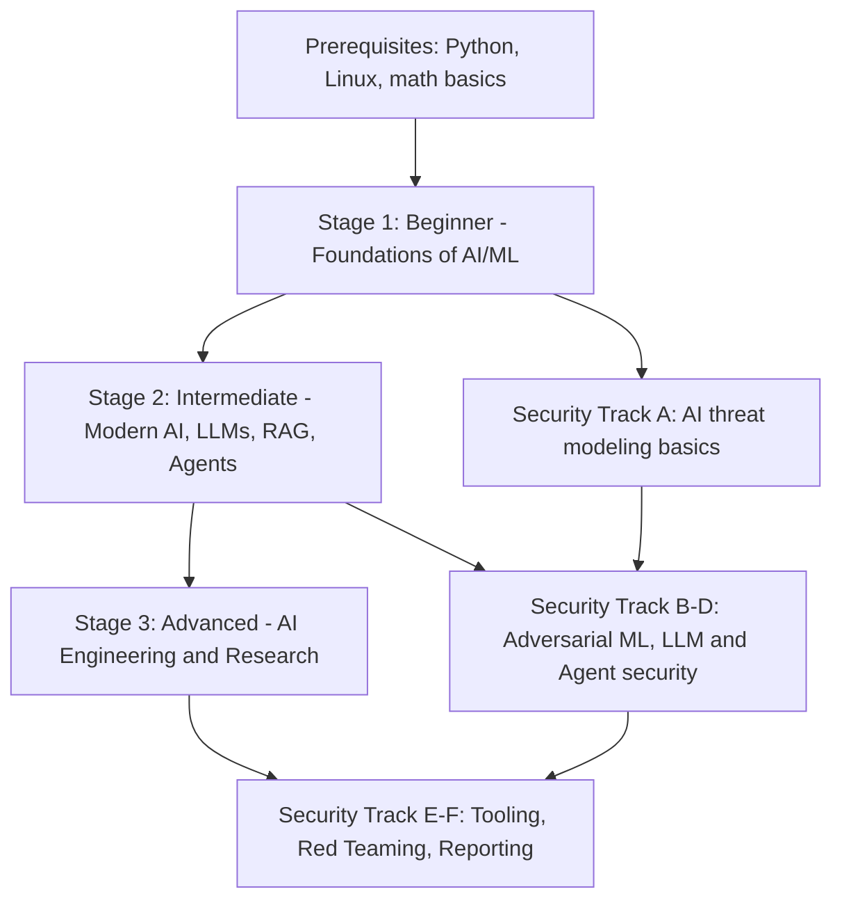
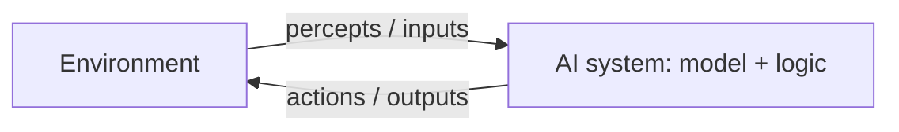
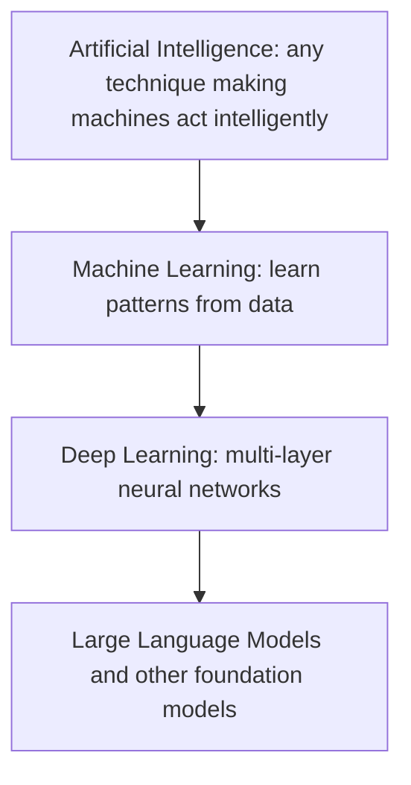
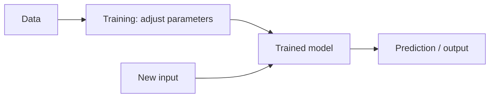

# AI Mastery Program: Roadmap and Lesson 001

*From beginner AI to AI engineering and AI security / penetration testing. Study notes by your AI professor.*

---

# PART 0: THE ROADMAP

## 0.1 The big picture



The security specialization is not saved for the end. Each stage has a **security checkpoint** so that you attack and defend what you just learned to build.

| Stage | Core goal | Security checkpoint (your strength, applied) |
| --- | --- | --- |
| **1. Beginner** | Understand how machines learn from data; train and evaluate first models | Threat-model an ML pipeline; data poisoning and evasion at toy scale |
| **2. Intermediate** | Understand and build with CNNs, transformers, LLMs, RAG, agents | Prompt injection, RAG poisoning, insecure output handling on your own lab apps |
| **3. Advanced** | Understand internals; fine-tune, optimize, deploy; interpretability and alignment | Adversarial ML attacks and defenses, model extraction, agent exploitation, full red-team engagement |
| **Specialization** | Professional AI pentesting | Garak, PyRIT, Promptfoo, ART, Foolbox, TextAttack, Burp, reports, retesting |

## 0.2 Stage 1: Beginner (about 8 to 12 weeks at 8 to 10 hours/week)

| Module | Topics |
| --- | --- |
| 1.1 | What AI is; history; types of AI (this is **Lesson 001**) |
| 1.2 | AI vs ML vs DL; how computers learn and decide |
| 1.3 | Python for AI: NumPy, Pandas, Matplotlib |
| 1.4 | Math 1: linear algebra (vectors, matrices, dot product) |
| 1.5 | Math 2: probability and statistics |
| 1.6 | Math 3: calculus (derivatives, gradients) |
| 1.7 | Data science: datasets, cleaning, preprocessing, feature engineering |
| 1.8 | Supervised learning: regression, classification |
| 1.9 | Unsupervised and reinforcement learning |
| 1.10 | Training, testing, validation, overfitting, metrics |
| 1.11 | Neural networks: neurons, weights, biases, hyperparameters |
| 1.12 | **Lab:** first model, then a neural network from scratch |

## 0.3 Stage 2: Intermediate

| Module | Topics |
| --- | --- |
| 2.1 | ML algorithms in depth (trees, forests, SVMs, boosting, k-means) |
| 2.2 | Backpropagation and deep learning with PyTorch (then TensorFlow) |
| 2.3 | CNNs; RNNs and LSTMs |
| 2.4 | NLP, tokenization, embeddings |
| 2.5 | Attention and transformers |
| 2.6 | LLMs: pretraining, fine-tuning, inference |
| 2.7 | Vector databases and RAG |
| 2.8 | Agents and agentic AI |
| 2.9 | Local models: Ollama, Hugging Face, quantization |
| 2.10 | Generative AI: image, audio, video |
| 2.11 | **Labs:** chatbot, RAG app, simple agent |

## 0.4 Stage 3: Advanced

Advanced architectures; LLM internals; pretraining, SFT, RLHF and preference optimization; LoRA/QLoRA; distributed training; GPU and CUDA fundamentals; compression; multimodal systems; interpretability; alignment and safety; research methodology; production deployment.

## 0.5 Security specialization (interleaved)

| Track | Content |
| --- | --- |
| **A** | AI threat modeling, OWASP Top 10 for LLM Applications, MITRE ATLAS, NIST AI RMF, attack surfaces |
| **B** | Adversarial ML: evasion, poisoning, extraction, inversion, membership inference, backdoors, defenses |
| **C** | LLM security: prompt injection (direct/indirect), jailbreaks, system prompt leakage, insecure output handling, excessive agency, RAG and vector DB attacks, LLM DoS |
| **D** | Agent security: tool-calling flaws, privilege escalation, memory poisoning, multi-agent risks |
| **E** | Tooling: Garak, PyRIT, Promptfoo, Giskard, ART, Foolbox, TextAttack, Burp Suite, custom scripts |
| **F** | Red teaming methodology, reproducible test cases, reporting, mitigation, retesting |

**Ground rule for every offensive exercise:** only intentionally vulnerable local labs, systems you own, or explicitly authorized targets.

## 0.6 Dependencies (what must come before what)

- Python before everything hands-on.
- Linear algebra and calculus before neural networks and backpropagation.
- Probability and statistics before evaluation, generative models, and membership inference.
- Neural networks before CNNs, RNNs, and transformers.
- Transformers before LLMs, RAG, agents, and all LLM security tracks.
- Adversarial ML (Track B) needs gradients (calculus) and trained models.
- Agent security (D) needs agents (2.8) and LLM security (C).

## 0.7 Prerequisites

| Area | Needed level | Plan |
| --- | --- | --- |
| **Programming** | Basic Python: variables, loops, functions, lists/dicts, files | You may know scripting from pentesting; we will cover Python-for-AI in Module 1.3 and teach as we go |
| **Math** | High-school algebra | Linear algebra, probability, calculus are taught step by step with numbers first, formulas second |
| **Technical** | Linux, CLI, networking, HTTP, web app testing | You already have this; we build on it directly (APIs, Burp, scripting) |

## 0.8 Recommended free and open-source environment

| Component | Recommendation |
| --- | --- |
| OS | Your existing Linux (Kali or Ubuntu); a separate VM for labs is wise |
| Python | Python 3.10+ with `venv` (one virtual environment per project) |
| Editor | VS Code, plus Jupyter notebooks (`jupyterlab`) |
| Core libraries | `numpy`, `pandas`, `matplotlib`, `scikit-learn` first; `torch` in Stage 2 |
| Local LLMs | Ollama (Stage 2) |
| Models/datasets | Hugging Face Hub |
| Compute | CPU is enough for Stage 1. For Stage 2/3 use a local GPU if you have one, or free tiers such as Google Colab or Kaggle notebooks |
| Version control | Git; keep all notes and labs in one repository |

Quick setup (verify versions on official docs; they change):

```bash
# create a project folder and an isolated Python environment
mkdir -p ~/ai-course && cd ~/ai-course
python3 -m venv .venv            # creates an isolated environment in .venv/
source .venv/bin/activate        # activates it (your prompt changes)
pip install --upgrade pip
pip install numpy pandas matplotlib scikit-learn jupyterlab
python -c "import sklearn; print(sklearn.__version__)"   # sanity check
```

## 0.9 How notes and labs are organized

```
ai-course/
├── notes/
│   ├── stage1-beginner/       lesson-001-intro-to-ai.md ...
│   ├── stage2-intermediate/
│   ├── stage3-advanced/
│   └── security/
├── labs/
│   ├── lab-001-first-model/   README.md, src/, data/, results/
│   └── ...
├── glossary.md                (running list of terms; I will give you additions after each lesson)
└── progress.md                (lessons done, quiz scores, weak topics)
```

**Every lesson** follows the 12-part structure:

- Introduction
- Fundamentals
- Technical Explanation
- Terminology
- Step-by-Step Examples 
- Practical Demonstration 
- Real-World Applications
- Cybersecurity Perspective
- Common Mistakes 
- Key Takeaways
- Exercises
- Knowledge Assessment.

**Every lab** has: objectives, tools, setup, steps, code, expected results, troubleshooting, security lessons.

**Progress tracking:** after each lesson, send me your exercise answers and quiz answers. I will grade them, record weak spots, and adapt. Keep `progress.md` yourself too; paste it to me if we start a new chat, since I may not remember earlier conversations.

---

# PART 1: LESSON 001

# Introduction to Artificial Intelligence: Understanding What AI Really Is

**Stage:** 1 (Beginner)  |  **Estimated time:** 2 to 3 hours  |  **Prerequisites:** none beyond basic Python

## 1. Topic Introduction

Artificial Intelligence (AI) is the field of computer science concerned with building systems that perform tasks that normally require human intelligence: perceiving, understanding language, reasoning, learning, deciding, and acting.

**Why it matters.** AI is now embedded in search, fraud detection, medical imaging, code assistants, and chat systems. For you specifically, it matters because every AI system is also a **new attack surface**. You cannot test what you do not understand, so we begin with what AI actually is, before we talk about breaking it.

**A useful honesty note:** "AI" is a moving label. Tasks once called AI (chess, OCR, spam filtering) are often called "just software" once they work. This is sometimes called the *AI effect*.

## 2. Fundamental Concepts

### 2.1 Two ways to get a computer to do something

1. **Explicit programming:** a human writes the rules. *If the email contains "WINNER", mark spam.*
2. **Learning from data:** a human supplies examples, and an algorithm *finds* the rules (as numbers inside a model).

Most of modern AI is the second approach. This single shift explains almost everything in this course, including why AI is hard to secure: **the "logic" is not written anywhere you can read; it is stored in learned numbers and shaped by data.**

### 2.2 Agents, environments, goals

The classic textbook framing (Russell and Norvig, *Artificial Intelligence: A Modern Approach*) is an **agent** that **perceives** an environment, **decides**, and **acts** to achieve a goal.



A spam filter perceives an email and acts by labeling it. A self-driving car perceives sensors and acts by steering. A chatbot perceives text and acts by producing text.

### 2.3 Four classic ways to define AI

| Approach | Idea | Example |
| --- | --- | --- |
| Thinking like a human | Model human cognition | Cognitive science models |
| Acting like a human | Pass for human (Turing Test) | Conversational bots |
| Thinking rationally | Logic and formal reasoning | Theorem provers |
| Acting rationally | Do what maximizes expected outcome | Most modern AI engineering |

Most practical AI today follows *acting rationally*: pick the action that best serves a goal given what is known.

## 3. Technical Explanation: History and Types

### 3.1 Timeline (key, well-established milestones)

| Period | Event |
| --- | --- |
| 1950 | Alan Turing publishes *Computing Machinery and Intelligence*, proposing the "imitation game" (Turing Test) |
| 1956 | Dartmouth workshop: the term "artificial intelligence" is coined (proposal by McCarthy, Minsky, Rochester, Shannon) |
| 1950s to 60s | Early symbolic AI, perceptron (Rosenblatt), first optimism |
| 1970s | Limits appear; funding drops: the first **AI winter** |
| 1980s | **Expert systems** (hand-written rules) boom commercially |
| Late 1980s to 90s | Second AI winter; statistical machine learning rises |
| 1997 | IBM Deep Blue defeats world chess champion Garry Kasparov |
| 2012 | Deep neural network (AlexNet) wins ImageNet by a large margin; **deep learning era** begins, fueled by data and GPUs |
| 2013 | Szegedy et al. show neural networks have **adversarial examples**: tiny input changes cause wrong outputs (first major security-relevant finding) |
| 2016 | AlphaGo defeats Lee Sedol at Go |
| 2017 | Vaswani et al., *Attention Is All You Need*: the **transformer** architecture |
| 2018 to now | Large language models (BERT, GPT family, and many open models) and generative AI go mainstream |

We will revisit every item in depth later. For now, note the pattern: **rules (symbolic AI) gave way to learning from data, and scale (data + compute) unlocked deep learning.**

### 3.2 Types of AI by capability

| Type | Meaning | Status |
| --- | --- | --- |
| **Narrow AI (ANI)** | Excellent at specific tasks, no general understanding | **All AI that exists today**, including chatbots, image classifiers, and game players |
| **General AI (AGI)** | Human-level ability across most intellectual tasks | Hypothetical; no agreed definition, timeline, or proof it has been achieved. Treat claims as contested |
| **Superintelligence (ASI)** | Far surpasses humans in nearly all domains | Theoretical; subject of philosophical and safety debate |

A frequent beginner trap: large language models are impressively *broad*, which leads people to call them "general." Whether that counts as progress toward AGI is an **open research debate**, not established fact. Keep "established" and "speculative" separate throughout this course.

### 3.3 Approaches to building AI

| Approach | How it works | Strength | Weakness |
| --- | --- | --- | --- |
| **Symbolic / rule-based** | Humans write rules and logic | Transparent, predictable | Brittle; cannot handle messy real-world input |
| **Machine learning** | Algorithm learns patterns from data | Handles complexity | Needs data; less interpretable |
| **Deep learning** | Many-layered neural networks learn features automatically | State of the art on images, speech, text | Data/compute hungry; opaque; vulnerable to adversarial inputs |

### 3.4 The relationship between AI, ML, and DL



They are **nested**, not synonyms. All deep learning is machine learning; all machine learning is AI; not all AI is machine learning (an old rule-based chess engine is AI without learning).

### 3.5 What "a model" is (a first look)

A **model** is a function with adjustable numbers (**parameters**) inside it:

```latex
\text{output} = f(\text{input};\ \text{parameters})
```

**Training** is the process of adjusting parameters so outputs match examples. **Inference** is using the trained model on new input. Everything else in the course elaborates on this loop:



## 4. Important Terminology

| Term | Definition |
| --- | --- |
| **Algorithm** | A step-by-step procedure for solving a problem |
| **Model** | A function with learned parameters that maps inputs to outputs |
| **Parameter** | A number inside the model adjusted during training (weights and biases are parameters; defined fully later) |
| **Data / dataset** | The examples a model learns from or is evaluated on |
| **Feature** | A measurable input property (e.g. email length) |
| **Label** | The correct answer attached to an example (e.g. "spam") |
| **Training** | Fitting the model's parameters to data |
| **Inference** | Running a trained model on new input to get a prediction |
| **Agent** | A system that perceives, decides, and acts toward a goal |
| **Narrow / General AI** | Task-specific vs hypothetical human-level broad intelligence |
| **Symbolic AI** | AI based on explicit rules and logic |
| **AI winter** | A period of reduced funding and interest after hype outpaced results |

Add these to your `glossary.md`.

## 5. Step-by-Step Example: Rules vs Learning

Task: classify short messages as **spam** or **not spam**.

**Approach A: rules.** You write: if the message contains "free" or "winner", it is spam.

| Message | Rule result | Truth | Correct? |
| --- | --- | --- | --- |
| "You are a winner, claim free prize" | spam | spam | Yes |
| "Lunch is free today, join us" | spam | not spam | **No** |
| "Cl@im your pr1ze now" | not spam | spam | **No** |

The rules fail in both directions: a *false positive* (good message flagged) and a *false negative* (spam gets through). Attackers deliberately exploit the second kind (note the misspelling). That is an **evasion attack**, already visible in our simplest example.

**Approach B: learning.** We give an algorithm many labeled messages. It counts which words tend to appear in spam versus non-spam and learns weights automatically. No human wrote "free = spam"; the model *derived* a tendency from data. Let us do exactly that.

## 6. Practical Demonstration

We will build both approaches in Python. Run inside the virtual environment from Part 0.

```python
# lesson001_demo.py
from sklearn.feature_extraction.text import CountVectorizer   # turns text into word counts
from sklearn.naive_bayes import MultinomialNB                  # a simple learning algorithm

# --- Approach A: hand-written rules ---
def rule_based(msg):
    msg = msg.lower()                          # lowercase so "FREE" matches "free"
    return "spam" if ("free" in msg or "winner" in msg) else "ham"   # 'ham' = not spam

# --- Approach B: learn from data ---
messages = [                                    # tiny training dataset (features)
    "win a free prize now", "claim your free reward", "you are a winner claim cash",
    "urgent claim prize money", "meeting at noon tomorrow", "lunch is free today join us",
    "please review the report", "project deadline is friday",
]
labels = ["spam", "spam", "spam", "spam", "ham", "ham", "ham", "ham"]   # correct answers

vectorizer = CountVectorizer()                  # will build a vocabulary of known words
X = vectorizer.fit_transform(messages)          # learn vocabulary AND convert messages to count vectors
model = MultinomialNB()                         # create the model (an empty function with parameters)
model.fit(X, labels)                            # TRAINING: parameters are set from the data

tests = ["claim your free prize", "lunch is free today", "project report deadline", "cl@im your pr1ze"]
learned = model.predict(vectorizer.transform(tests))   # INFERENCE: predict on new, unseen text

for msg, pred in zip(tests, learned):
    print(f"{msg!r:30} rules={rule_based(msg):5} learned={pred}")
```

```bash
python lesson001_demo.py
```

**What each important part does**

- `CountVectorizer` converts text into numbers (counts of each word), because models operate on numbers, not raw text. This is a first taste of **feature extraction**.
- `fit_transform` first learns the vocabulary, then converts the data.
- `MultinomialNB()` creates a Naive Bayes classifier: a simple probabilistic model. We will derive how it works in Stage 1 (it uses probability, which is why we study statistics).
- `model.fit(X, labels)` is **training**.
- `model.predict(...)` is **inference**. Note we use `vectorizer.transform` (not `fit_transform`) on test data so the vocabulary stays fixed.

**Expected observations (your exact output may vary slightly):** the learned model should handle "lunch is free today" better than the naive rule because it has seen "free" in both classes and weighs other words too. The obfuscated `cl@im your pr1ze` contains words the model never saw, so it has little to go on: **both approaches are fooled by spelling tricks**. Record what *you* see. Also notice our dataset has only 8 rows; real systems use thousands to millions, and tiny datasets are unreliable. That is a lesson in itself.

## 7. Real-World Applications

| Domain | Example | AI type |
| --- | --- | --- |
| Email/security | Spam and phishing filters, malware classification, anomaly detection in logs | ML |
| Vision | Face unlock, medical image analysis, quality inspection | Deep learning |
| Language | Translation, chatbots, code assistants | LLMs |
| Recommendation | Video, music, shopping | ML |
| Finance | Fraud detection, credit scoring | ML |
| Robotics and vehicles | Navigation, driver assistance | ML plus control |

## 8. Cybersecurity Perspective

Even in Lesson 001 we can see the shape of AI security:

1. **Logic lives in data and parameters, not code.** You cannot grep for the bug. This changes how you audit.
2. **Evasion.** Attackers craft inputs that the model misclassifies (our `cl@im` example). At scale this is *adversarial machine learning* (Szegedy et al., 2013; Track B).
3. **Data dependency.** If the training data is manipulated, the model's behavior is manipulated: **data poisoning** (Track B).
4. **Models leak.** Trained models can reveal information about their training data or be copied via queries (**membership inference, model extraction**).
5. **Applications around the model matter.** In LLM systems, most real-world findings involve the *surrounding application* (prompts, tools, retrieval, output handling), which is why OWASP maintains a Top 10 for LLM Applications.
6. **Attackers use AI too:** phishing generation, automated reconnaissance, and so on, relevant for defenders' threat models.

Security frameworks you will meet later: **OWASP Top 10 for LLM Applications**, **MITRE ATLAS** (adversary tactics and techniques against AI systems, modeled on ATT&CK), and the **NIST AI Risk Management Framework (AI RMF 1.0)**. We will read the *current* versions from their official sites when we reach them, because these documents are updated.

A first threat-modeling habit: for any AI system, ask *What are its inputs? Who controls them? What data trained it? What can its outputs trigger? What does it have access to?*

## 9. Common Mistakes and Misconceptions

| Misconception | Reality |
| --- | --- |
| "AI, ML, and deep learning are the same thing" | They are nested categories |
| "AI understands like a human" | Models find statistical patterns; whether this equals understanding is debated. Do not assume human-like reasoning |
| "Today's AI is general intelligence" | All deployed AI is narrow by the standard definition; AGI claims are contested |
| "More data always fixes everything" | Bad, biased, or poisoned data produces bad models |
| "A model that works in testing is secure" | Accuracy on normal data says nothing about robustness against deliberate attack |
| "AI output is objective" | It reflects its data, objective, and design choices |
| "AI is magic" | It is math, data, and engineering, which you will learn completely |

## 10. Key Takeaways

- AI = building systems that perceive, decide, and act intelligently. ML = learning from data. DL = ML with deep neural networks. They nest.
- A model is a function with learned parameters; **training** sets them, **inference** uses them.
- All existing AI is narrow; AGI and superintelligence are hypothetical.
- History moved from hand-written rules to data-driven learning, accelerated by compute and the transformer.
- Learned systems fail differently from traditional software. The same properties that make them powerful (logic from data) create their attack surface.

## 11. Exercises

**Exercise 1 (concept).** In your own words (3 to 5 sentences), explain the difference between explicit programming and machine learning. Give one task where rules are better than learning, and why.

**Exercise 2 (classification).** Classify each as AI-but-not-ML, ML-but-not-DL, or DL, and justify: (a) a hand-written chess engine that searches moves with rules, (b) a decision-tree loan-approval model, (c) a model that recognizes faces in photos using a many-layer neural network.

**Exercise 3 (hands-on).** Run `lesson001_demo.py`. Then:

1. Add 6 more labeled messages of your own (3 spam, 3 ham) and retrain. Did predictions change?
2. Add 3 new test messages that you think will fool the *rule-based* method, and 3 that will fool the *learned* model. Record which succeeded.
3. Write 3 sentences explaining why the obfuscated message is a security-relevant observation.

**Exercise 4 (security thinking).** Pick any AI product you use. List its inputs, who controls them, and what its outputs can trigger. Name one way an attacker might abuse it. This is your first mini threat model.

**Exercise 5 (research habit).** Find the original abstract of *Attention Is All You Need* (Vaswani et al., 2017) and Szegedy et al., *Intriguing Properties of Neural Networks* (2013). Write one sentence on each stating the main claim. You do not need to understand the math yet.

## 12. Knowledge Assessment

1. Which is the correct nesting: (a) DL contains ML contains AI, (b) AI contains ML contains DL, (c) ML contains AI contains DL?
2. What is the difference between **training** and **inference**?
3. What is a **parameter**? What is a **feature**? What is a **label**?
4. Is ChatGPT-style AI an example of narrow AI, general AI, or superintelligence? Explain why this is more subtle than it looks.
5. What was the first AI winter, and what pattern does it illustrate?
6. Why can't you find a learned model's "bug" by reading source code the way you would in a web app?
7. In the spam example, what is a false positive and a false negative? Which does an attacker usually aim for?
8. Name two attack categories from Section 8 and describe each in one sentence.
9. *Challenge:* Why might a model trained on only 8 examples be unreliable even if it scores perfectly on those 8?
10. *Challenge:* A vendor says, "Our AI is 99% accurate, so it's secure." Write a short rebuttal.

## Further Reading and References

- Russell, S. and Norvig, P. *Artificial Intelligence: A Modern Approach* (standard textbook; Chapter 1).
- Turing, A. (1950). *Computing Machinery and Intelligence.* Mind.
- Vaswani et al. (2017). *Attention Is All You Need.* (arXiv)
- Szegedy et al. (2013). *Intriguing Properties of Neural Networks.* (arXiv)
- scikit-learn documentation: scikit-learn.org (verify current version and API there)
- OWASP Top 10 for LLM Applications (owasp.org), MITRE ATLAS (atlas.mitre.org), NIST AI RMF (nist.gov)

---

## Next Steps

1. Save this document as `notes/stage1-beginner/lesson-001-intro-to-ai.md` and the roadmap as `roadmap.md`.
2. Set up your environment (Part 0.8) and run the demo.
3. Send me your answers to Exercises 1 to 4 and Assessment questions 1 to 10. I will grade them, correct gaps, and adapt Lesson 002.

**Lesson 002 preview:** *AI vs ML vs DL in depth, and how computers learn and make decisions*, introducing the learning loop (data, model, loss, update) and the three learning paradigms.
