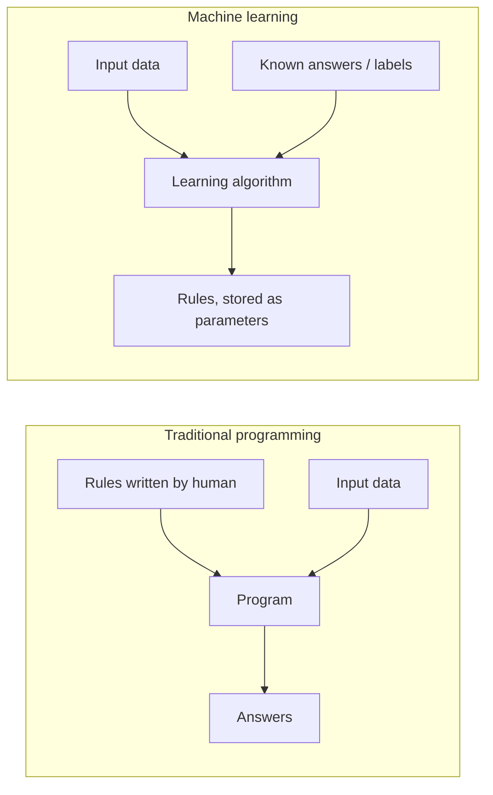
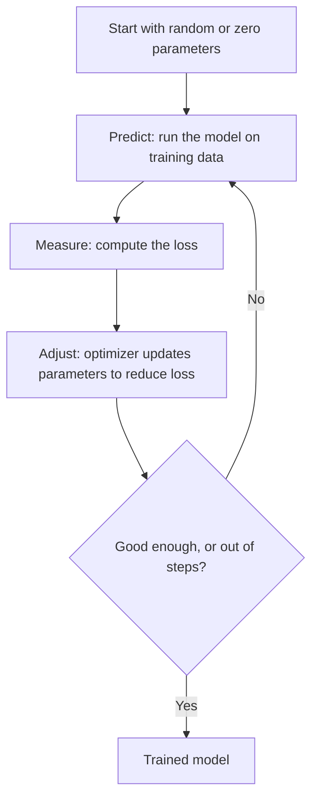
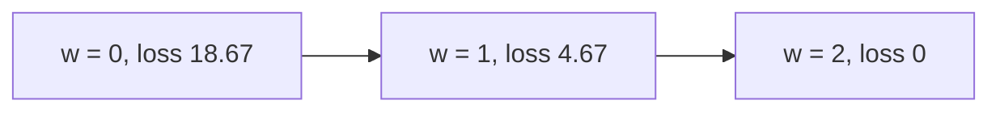
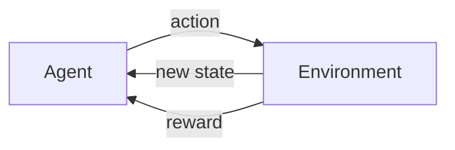

# Lesson 002: How Computers Learn and Make Decisions

**Stage:** 1 (Beginner)  |  **Module:** 1.2  |  **Estimated time:** 3 to 4 hours  |  **Prerequisites:** Lesson 001 (what AI, ML, DL, a model, training and inference are)

**Where we are:** In Lesson 001 you learned that a model is a function with adjustable numbers (parameters) and that training sets those numbers from data. This lesson opens the box: *how exactly does a computer adjust those numbers, and how does it turn them into a decision?* By the end you will have trained a model by hand, line by line, and you will understand the single idea that powers almost all of modern AI, including the LLMs we will study later.

---

## 1. Topic Introduction

There is one core idea in this lesson, and everything else hangs off it:

> **Machine learning is trial and error, done with numbers. Guess, measure how wrong the guess was, adjust, repeat.**

That is it. No magic. A model starts with bad guesses. We measure how bad they are with a single number called the **loss**. Then an algorithm nudges the parameters in whichever direction makes the loss smaller. We repeat this thousands or millions of times. The model gets better.

**Why it matters for you:** You cannot reason about attacks like data poisoning, adversarial examples, or reward hacking until you know what is being optimized and what the optimizer can be tricked into. Every one of those attacks targets a piece of the loop you will learn today.

**What you will learn:**

1. AI vs ML vs DL, in more depth than Lesson 001.
2. How "programming by rules" differs from "programming by examples".
3. The learning loop: prediction, loss, update.
4. A fully worked numeric example you can check with a calculator.
5. The three learning paradigms: supervised, unsupervised, reinforcement.
6. How a model's numbers become an actual decision.
7. Your first hands-on code, plus a small security experiment.

---

## 2. Fundamental Concepts

### 2.1 AI, ML, and DL revisited (with an analogy)

Imagine teaching someone to cook.

- **Rule-based AI** is handing them a **recipe**. Every step is written by you. It works perfectly for that dish, and fails the moment the ingredients change.
- **Machine learning** is letting them **taste hundreds of dishes** with a score for each ("this one is good, this one is bad") and letting them figure out the patterns of what makes food good.
- **Deep learning** is the same tasting process, but the learner has a **very large brain with many layers of pattern detectors**. The early layers notice simple things (salty, sweet), later layers combine them into complex ideas ("balanced", "too heavy").

|  | Rule-based AI | Machine Learning | Deep Learning |
| --- | --- | --- | --- |
| Who writes the logic? | A human, explicitly | The algorithm, from data | The algorithm, from lots of data |
| What are the inputs you must prepare? | Rules | Data plus hand-chosen **features** | Mostly raw data (pixels, text, audio) |
| Typical data needed | None | Hundreds to thousands of examples | Often many thousands to billions |
| Interpretability | High | Medium (depends on algorithm) | Low (hard to explain why) |
| Typical examples | Tax software, early chess engines | Spam filter, credit scoring, recommendations | Image recognition, speech, ChatGPT-style LLMs |
| Compute needed | Tiny | Small to moderate | Often GPUs |

**What is a feature, again?** A feature is a measurable property of an input. For a house: size, number of rooms, distance to the city. In classic ML, a human chooses the features. In deep learning, the network learns useful features itself. This is a big reason deep learning took over images and language.

### 2.2 Programming by rules vs programming by examples



In traditional programming, **rules + data = answers**. In machine learning, **data + answers = rules** (and the rules live inside the model's parameters).

After training, you use those learned rules on new data: **new data + learned rules = predicted answers**. That final step is **inference**.

### 2.3 The four ingredients of every learning system

Almost every ML system, from a tiny spam filter to a giant LLM, has these four parts. Memorize them; we will use them constantly.

| Ingredient | Plain meaning | Our running example |
| --- | --- | --- |
| **Data** | Examples to learn from | Pairs (hours studied, exam score) |
| **Model** | A function with adjustable parameters that makes predictions | score = w \* hours |
| **Loss function** | A number that says how wrong the model is | Average squared error |
| **Optimizer** | The procedure that adjusts parameters to reduce loss | Gradient descent |

---

## 3. Technical Explanation: The Learning Loop

### 3.1 The loop



Each pass through the loop on the data is one **step** (or, when it covers the whole dataset, one **epoch**; we will be precise about these later).

### 3.2 Worked example: teaching a model a pattern, by hand

Suppose students studied for 1, 2, and 3 hours and scored 2, 4, and 6 points on a quiz. You and I can see the pattern: score = 2 x hours. But the computer does not know that. We give it this model:

```latex
\hat{y} = w \cdot x
```

Read this as: *the prediction (y-hat) equals the parameter w times the input x.* Here **x** is hours studied, **y** is the true score, and **y-hat** (written "y hat") is the model's prediction. The model has exactly one parameter, **w** (a weight). The computer's job is to find the right value of w.

**Our data**

| Example | x (hours) | y (true score) |
| --- | --- | --- |
| 1 | 1 | 2 |
| 2 | 2 | 4 |
| 3 | 3 | 6 |

**Step A: Make a bad first guess.** Start with w = 0. Then the model predicts 0 for everything.

**Step B: Measure the error.** For each example, error = prediction minus truth. Then square it (this makes every error positive and punishes big mistakes more). Then average. This is called the **Mean Squared Error (MSE)**, a very common loss function.

| x | y (true) | prediction (w=0) | error (pred - true) | squared error |
| --- | --- | --- | --- | --- |
| 1 | 2 | 0 | -2 | 4 |
| 2 | 4 | 0 | -4 | 16 |
| 3 | 6 | 0 | -6 | 36 |

Loss = (4 + 16 + 36) / 3 = 56 / 3 = **18.67**. That is a big loss, meaning a bad model.

**Step C: Try another value, just to see.** If w = 1, predictions are 1, 2, 3, errors are -1, -2, -3, squared 1, 4, 9, loss = 14 / 3 = **4.67**. Better. If w = 2, predictions are 2, 4, 6, every error is 0, loss = **0**. Perfect.

So the loss acts like a landscape: high when w is wrong, lowest at w = 2. Learning means **walking downhill** on this landscape.



**Step D: But how does the computer know which way to go?** We cannot just try every w; real models have billions of parameters. We need a rule that says *"to make the loss smaller, increase w"* or *"decrease w"*, and *how steeply* the loss changes. That quantity is the **gradient**.

**Intuition for the gradient (no calculus yet).** Stand on a hillside in fog. You cannot see the valley, but you can feel the slope under your feet. The gradient is the slope. It tells you which direction is *uphill*. To go down, you step in the **opposite** direction. Calculus (Module 1.6) gives us a precise formula for the slope; for our MSE loss with one parameter it is:

```latex
\text{gradient} = \frac{2}{n} \sum_{i=1}^{n} (\hat{y}_i - y_i)\, x_i
```

In words: for each example, multiply its error by its input x, add them all up, multiply by 2, divide by the number of examples n. Do not worry about *why* the formula looks like this yet; we will derive it in the calculus module. For now just learn to *use* it.

**Step E: Compute the gradient at w = 0.**

- Example 1: error -2, times x = 1, gives -2
- Example 2: error -4, times x = 2, gives -8
- Example 3: error -6, times x = 3, gives -18
- Sum = -28. Gradient = (2 / 3) x (-28) = **-18.67**

The gradient is **negative**. That means: as w increases, the loss goes *down* (we are on a downhill slope heading right). So we should increase w.

**Step F: The update rule.**

```latex
w_{\text{new}} = w_{\text{old}} - \eta \cdot \text{gradient}
```

The symbol eta is the **learning rate**: how big a step to take. Let us pick **learning rate = 0.05**. This is a **hyperparameter**, a setting that *we* choose rather than one the model learns.

```latex
w_{\text{new}} = 0 - 0.05 \times (-18.67) = 0.9333
```

The minus sign in front of the gradient is what makes us walk *downhill*. A negative gradient times a minus gives a positive step. So w moved from 0 to 0.933. One step of learning is complete.

**Step G: Repeat.** With w = 0.9333:

- predictions: 0.933, 1.867, 2.800
- errors: -1.067, -2.133, -3.200
- error x input: -1.067, -4.267, -9.600, sum = -14.933
- gradient = (2 / 3) x (-14.933) = -9.956
- new w = 0.9333 - 0.05 x (-9.956) = **1.431**

Notice: w moved from 0.93 to 1.43, closer to 2. The steps got *smaller* because the slope got gentler as we approached the bottom of the valley. Keep going and w settles at 2.0. **You have just trained a model.** Everything else in deep learning is this loop, scaled up to millions or billions of parameters.

### 3.3 What does the learning rate do?

| Learning rate | Behavior | Analogy |
| --- | --- | --- |
| Too small | Learns, but painfully slowly | Walking down a mountain one centimeter at a time |
| Just right | Smooth, steady improvement | A confident walk downhill |
| Too large | Overshoots, bounces around, or **diverges** (loss explodes) | Leaping so far you jump over the valley to the other side, higher up |

You will test this yourself in the lab (a learning rate of 0.25 on this exact problem blows up).

### 3.4 Scaling up

Our model had **one** parameter. Real models have the same structure with **many**:

| Model | Parameters | Same loop? |
| --- | --- | --- |
| Our toy model | 1 | Yes |
| Simple spam filter | thousands | Yes |
| Image classifier | millions | Yes |
| Large language model | billions | Yes |

The gradient becomes a *list* with one slope per parameter; the update moves every parameter a little. The algorithm for computing all those slopes efficiently in a neural network is called **backpropagation** (Stage 2).

### 3.5 Generalization: the real goal

A model that gets loss = 0 on its training data is not automatically good. We care about **new data it has never seen**. If it memorizes training examples instead of learning the underlying pattern, it has **overfit**. This is why we split data into a **training set** (to learn from) and a **test set** (to evaluate honestly). We will dig into this in Module 1.10; for now just remember: **training performance is not the goal, performance on unseen data is.**

---

## 4. The Three Learning Paradigms

The loop is always the same, but *what kind of feedback* the model receives defines the type of learning.

### 4.1 Supervised learning: learning with an answer key

Every training example comes with the correct answer (a **label**). The model predicts, compares to the label, and adjusts. This is exactly what our worked example did.

Two main task types:

| Task | Output | Examples |
| --- | --- | --- |
| **Regression** | A number | House price, temperature tomorrow, exam score |
| **Classification** | A category | Spam or not spam, malware or benign, cat or dog |

**Typical supervised pipeline:** collect labeled data, split train/test, train, evaluate, deploy.

### 4.2 Unsupervised learning: finding structure without answers

There are **no labels**. The algorithm looks for structure by itself.

| Task | Idea | Examples |
| --- | --- | --- |
| **Clustering** | Group similar items | Customer segments, grouping similar malware samples |
| **Dimensionality reduction** | Compress many features into fewer | Visualizing high-dimensional data |
| **Anomaly detection** | Learn "normal", flag the unusual | Unusual login patterns, odd network traffic |

Analogy: dump a pile of unlabeled photos on a table and sort them into piles of "things that look alike" without being told what the piles mean.

### 4.3 Reinforcement learning (RL): learning from rewards

An **agent** interacts with an **environment**. It takes **actions**, observes the new **state**, and receives a **reward** (a score, positive or negative). It learns a **policy** (a strategy for choosing actions) that maximizes total reward over time.



Analogy: training a dog with treats. Nobody explains the rules; the dog discovers which behaviors earn treats. Examples: game-playing agents (AlphaGo), robot control, and, importantly for later, **RLHF**, the technique used to fine-tune chat models from human preference feedback.

### 4.4 A note on self-supervised learning

You will hear this term constantly. In **self-supervised learning** the labels come from the data itself. For example, hide a word in a sentence and ask the model to predict it; the hidden word is the label. This is how large language models are pretrained. It is technically a form of learning without human-written labels, but it uses a supervised-style loss. We will study it properly in Stage 2.

### 4.5 Comparison

|  | Supervised | Unsupervised | Reinforcement |
| --- | --- | --- | --- |
| Feedback | Correct answer per example | None | Reward signal (often delayed) |
| Goal | Predict labels | Discover structure | Maximize cumulative reward |
| Typical data | Labeled dataset | Unlabeled dataset | Interaction with an environment |
| Example | Spam detection | Customer clustering | Game-playing agent |

---

## 5. How Computers Make Decisions

A trained model does not produce "decisions" directly; it produces **numbers**. A decision is what we build on top of those numbers.

**Example: spam classification.** Given an email, a classification model outputs a **score** or **probability**, say 0.87, meaning 87% estimated chance of spam. The *application* then applies a **decision rule**:

```
if probability >= threshold (say 0.5):  move to spam folder
else:                                    keep in inbox
```

Three important consequences:

1. **The threshold is a policy choice, not a fact.** Lowering it catches more spam (fewer false negatives) but flags more good mail (more false positives). Raising it does the reverse. The right setting depends on the cost of each mistake: a bank fraud system and a music recommender weigh errors very differently.
2. **Confidence is not correctness.** A model can output 0.99 and be wrong, especially on inputs unlike its training data.
3. **Decisions can be automated, human-reviewed, or mixed.** A common design is: high confidence acts automatically, low confidence goes to a human.

In regression the output is a number used directly (a predicted price). In reinforcement learning, the policy maps the current state to an action.

---

## 6. Important Terminology

| Term | Definition |
| --- | --- |
| **Prediction (y-hat)** | The model's output for an input |
| **Label / target (y)** | The correct answer for a training example |
| **Loss function** | A formula that turns "how wrong" into a single number (lower is better) |
| **MSE** | Mean Squared Error: average of squared errors; common for regression |
| **Optimizer** | The algorithm that updates parameters to reduce loss |
| **Gradient** | The slope of the loss with respect to a parameter; points uphill |
| **Gradient descent** | Repeatedly stepping parameters opposite to the gradient to reduce loss |
| **Learning rate** | The step size of each update; a hyperparameter |
| **Hyperparameter** | A setting chosen by the human, not learned (learning rate, number of steps) |
| **Parameter / weight** | A number the model learns during training |
| **Epoch** | One full pass through the training dataset |
| **Convergence** | Loss stops improving meaningfully; training has settled |
| **Divergence** | Loss grows instead of shrinking (often a too-large learning rate) |
| **Overfitting** | Memorizing training data and failing on new data |
| **Generalization** | Performing well on unseen data |
| **Regression / Classification** | Predict a number / predict a category |
| **Clustering** | Grouping unlabeled data by similarity |
| **Agent / Reward / Policy** | RL: the learner / the feedback score / the action strategy |
| **Threshold** | The cutoff that turns a probability into a decision |

Add these to your `glossary.md`.

---

## 7. Practical Demonstration

Set up your environment from the roadmap (activate your `.venv`). We will do four things: (A) train the worked example from scratch, (B) break it with bad learning rates, (C) do the same job with a library, and (D) see a decision threshold and clustering in action.

### 7.1 Gradient descent from scratch

No libraries needed. Save as `lesson002_gd.py`.

```python
# lesson002_gd.py: train y = w * x using gradient descent, by hand

xs = [1, 2, 3]            # inputs: hours studied
ys = [2, 4, 6]            # true answers (labels): quiz scores

w = 0.0                   # our single parameter, starting from a bad guess
lr = 0.05                 # learning rate (a hyperparameter we choose)

for step in range(1, 21):                             # repeat the loop 20 times
    preds = [w * x for x in xs]                       # 1) PREDICT for every example
    errors = [p - y for p, y in zip(preds, ys)]       # error = prediction - truth
    loss = sum(e ** 2 for e in errors) / len(xs)      # 2) MEASURE: mean squared error
    grad = 2 * sum(e * x for e, x in zip(errors, xs)) / len(xs)   # slope of loss wrt w
    w = w - lr * grad                                 # 3) ADJUST: step downhill
    print(f'step {step:2d}  loss before update = {loss:8.4f}  new w = {w:.4f}')

print('final w:', round(w, 4))
```

```bash
python lesson002_gd.py
```

**Line by line**

- `xs`, `ys`: the dataset. `zip(...)` pairs elements from two lists so we can walk through them together.
- `w = 0.0`: our starting guess; every learning problem starts from some initial parameters.
- `lr = 0.05`: the step size.
- `preds = [w * x for x in xs]`: a *list comprehension*; computes the model's prediction for each input.
- `errors`: prediction minus truth for each example.
- `loss`: squares each error, adds them, divides by the count: MSE.
- `grad`: exactly the formula from section 3.2, written in Python.
- `w = w - lr * grad`: **the update rule**. This single line is "learning".

**Expected output.** Step 1 should show a loss before update of about 18.6667 and a new w of about 0.9333; step 2 should show a new w of about 1.4311 (matching our hand calculation). By step 20 the final w should be extremely close to 2.0. If your first two steps match the hand math, you understand gradient descent.

### 7.2 Break it on purpose: learning rate experiments

Change `lr = 0.05` to each of the following and re-run. Record what happens.

| lr | Prediction | What to look for |
| --- | --- | --- |
| 0.001 | Very slow | w still far from 2 after 20 steps |
| 0.05 | Good | Converges smoothly |
| 0.25 | Diverges | Loss gets *larger* every step and w swings wildly |

### 7.3 The same task with a library (scikit-learn)

```python
# lesson002_sklearn.py
from sklearn.linear_model import LinearRegression   # a ready-made regression model

X = [[1], [2], [3]]        # scikit-learn expects a 2D list: rows = examples, columns = features
y = [2, 4, 6]              # labels

model = LinearRegression(fit_intercept=False)   # no bias term, to match our w * x model
model.fit(X, y)                                 # TRAINING (the library does the optimizing)

print('learned w:', model.coef_[0])             # coef_ holds the learned weights
print('prediction for 10 hours:', model.predict([[10]])[0])   # INFERENCE
```

Expected: learned w near 2.0, prediction near 20. Notice that `fit()` hides the loop we just wrote. Libraries are convenient, but you now know what is inside the box.

### 7.4 From probability to decision

```python
# lesson002_threshold.py
from sklearn.linear_model import LogisticRegression   # a classifier that outputs probabilities

X = [[1], [2], [3], [7], [8], [9]]   # feature: e.g. count of suspicious words in a message
y = [0, 0, 0, 1, 1, 1]               # labels: 0 = ham, 1 = spam

clf = LogisticRegression()
clf.fit(X, y)                                        # TRAINING

for value in [2, 4, 5, 6, 8]:
    p = clf.predict_proba([[value]])[0][1]           # probability of class 1 (spam)
    for threshold in (0.3, 0.5, 0.8):
        decision = 'SPAM' if p >= threshold else 'ham'   # the decision rule
        print(f'x={value}  p(spam)={p:.2f}  threshold={threshold}  ->  {decision}')
    print()
```

What to notice: for in-between inputs like 4, 5, 6 the decision flips depending on the threshold you chose. The model gave the probability; **you** (or the engineer) chose the policy.

### 7.5 Unsupervised taste: clustering

```python
# lesson002_kmeans.py
from sklearn.cluster import KMeans    # a clustering algorithm (no labels needed)

points = [[1, 1], [1, 2], [2, 1], [8, 8], [8, 9], [9, 8]]   # two obvious groups, no labels
km = KMeans(n_clusters=2, n_init=10, random_state=0)         # ask for 2 groups
km.fit(points)                                               # learn the groups
print('assigned groups:', km.labels_)                        # which group each point joined
print('group centers:', km.cluster_centers_)
```

The algorithm was never told what the groups mean; it found them from the shape of the data. The numbers 0 and 1 are arbitrary group names.

---

## 8. Real-World Applications

| Paradigm | Application | What is being learned |
| --- | --- | --- |
| Supervised (classification) | Phishing URL detector | Features of URLs, labeled phishing or safe |
| Supervised (regression) | Predicting time-to-resolve for tickets | Number from past tickets |
| Unsupervised (clustering) | Grouping malware samples into families | Similarity between samples |
| Unsupervised (anomaly detection) | Detecting unusual account behavior | What "normal" looks like |
| Reinforcement | Game agents, robotics, tuning chatbots from human feedback | Policy that earns reward |
| Self-supervised | Pretraining language models | Predicting hidden or next words |

---

## 9. Cybersecurity Perspective

Every element of the learning loop is something an attacker may target. Keep this table; we will return to every row in the security track.

| Part of the loop | Attack idea (conceptual) | Later topic |
| --- | --- | --- |
| **Data** | Insert or alter training examples so the model learns wrong or hidden behavior | Data poisoning, backdoors |
| **Labels** | Flip labels on a small portion of data | Label-flipping poisoning |
| **Loss / objective** | The model optimizes what you *measure*, not what you *meant* | Specification gaming, reward hacking |
| **Reward (RL)** | The agent finds loopholes that earn reward without doing the intended task | Reward hacking, RLHF risks |
| **Gradient** | The same gradient used to train can be computed with respect to the *input*, to find tiny input changes that flip the output | Adversarial examples (evasion) |
| **Decision threshold** | Attackers probe to find the score boundary and stay just under it | Evasion, detection bypass |
| **Predictions via API** | Many queries reveal how the model behaves, enabling copying | Model extraction, membership inference |
| **Unsupervised models** | Slowly shift what counts as "normal" so abnormal behavior goes unflagged | Poisoning anomaly detectors |

**Key insight:** *Training and attacking use the same mathematics.* Training adjusts parameters to reduce loss on the training data. Many evasion attacks adjust the **input** to increase loss for the correct answer. You are learning the defender's and attacker's tool at once.

### Mini security lab: label flipping (safe, local, toy data)

This is a tiny experiment on your own toy data to *see* poisoning rather than just read about it.

```python
# lesson002_poison.py   (your own toy data, local only)
from sklearn.linear_model import LogisticRegression

X = [[1], [2], [3], [4], [6], [7], [8], [9]]

clean_y    = [0, 0, 0, 0, 1, 1, 1, 1]      # honest labels
poisoned_y = [0, 0, 0, 1, 1, 1, 1, 1]      # attacker flips the label of the example at x=4

for name, labels in (('clean', clean_y), ('poisoned', poisoned_y)):
    m = LogisticRegression().fit(X, labels)
    print(name, 'p(spam) at x=3:', round(m.predict_proba([[3]])[0][1], 3),
          ' at x=4.5:', round(m.predict_proba([[4.5]])[0][1], 3))
```

**Your task:** compare the two rows. Which direction did the probabilities shift, and why? Then try flipping a different example, or two examples, and observe how the damage depends on *which* points are flipped. Write 3 sentences explaining what this teaches about trusting training data. (Real poisoning is far subtler and harder to detect; this only shows the principle.)

---

## 10. Common Mistakes and Misconceptions

| Misconception | Reality |
| --- | --- |
| "The model learns by understanding the rules" | It adjusts numbers to reduce a loss; any understanding is emergent and debated |
| "Zero training loss means a great model" | It may just have memorized the data (overfitting) |
| "A bigger learning rate is always faster" | Too large and training diverges |
| "The gradient points downhill" | It points **uphill**; we subtract it to go downhill |
| "The model makes the decision" | The model outputs scores; humans or code set the thresholds and rules |
| "High confidence means correct" | Confidence can be high and wrong, especially on unfamiliar inputs |
| "Unsupervised means no human involvement" | Humans still pick features, number of clusters, and interpret results |
| "Parameters and hyperparameters are the same" | Parameters are learned; hyperparameters are chosen by you |
| "Reinforcement learning needs no data" | It generates its own data by interacting, and often needs enormous amounts |
| Skipping the math because it looks scary | Redo the worked example once with a calculator. It is only multiplication and addition |

---

## 11. Key Takeaways

- ML is a loop: **predict, measure loss, adjust, repeat**. All of deep learning, including LLMs, is this loop at scale.
- Traditional programming: rules + data = answers. ML: data + answers = rules (stored in parameters).
- Four ingredients: **data, model, loss function, optimizer**.
- **Gradient descent** moves parameters opposite to the gradient: `w = w - lr * grad`. The learning rate controls step size.
- The goal is **generalization** to unseen data, not a perfect score on training data.
- Three paradigms: **supervised** (labels), **unsupervised** (structure), **reinforcement** (rewards). Self-supervised learning creates labels from the data itself.
- Models output **numbers**; decisions come from thresholds and rules built on top of them.
- Security: every piece of the loop (data, labels, loss, reward, gradient, thresholds, API access) is a potential attack surface.

---

## 12. Exercises

**Exercise 1 (hand calculation).** Using the same data (x = 1, 2, 3; y = 2, 4, 6), start at **w = 4** (too high) with learning rate 0.05. Compute the loss, the gradient, and the new w for **one step** by hand. Is the gradient positive or negative this time? Which direction does w move and why?

**Exercise 2 (new data).** Change the data to x = 1, 2, 3 and y = 3, 6, 9. Run `lesson002_gd.py`. What should the final w be? Did it get there? How many steps did it take to get within 0.01 of the answer?

**Exercise 3 (learning rate).** Run the from-scratch script with lr = 0.001, 0.05, 0.2, and 0.25. Make a small table of the loss at step 20 for each. Explain in your own words what is happening for the value that diverges. (Optional extra: find roughly the largest learning rate that still converges.)

**Exercise 4 (classify the paradigm).** For each, state supervised, unsupervised, or reinforcement, and say why. If supervised, say regression or classification.

- a) Predicting a used car's price from its age and mileage.
- b) Grouping customers by purchase behavior with no predefined categories.
- c) A program learning to play a video game by trying moves and seeing its score.
- d) Labeling network connections as malicious or benign from a labeled dataset.
- e) Finding an unusual spike in server logs with no examples of attacks.

**Exercise 5 (decision thresholds).** Run `lesson002_threshold.py`. For x = 5, write down the decision at thresholds 0.3, 0.5, 0.8. Then answer: for (a) a spam filter, (b) a system flagging fraudulent bank transfers, which threshold direction would you lean toward, and why? Think about the cost of each type of mistake.

**Exercise 6 (security lab).** Complete the label-flipping lab above, including the three-sentence reflection.

**Exercise 7 (threat model).** Pick the RL paradigm. Imagine a robot vacuum rewarded for "amount of dust collected". Describe one way it could earn reward without doing the job properly (a reward-hacking example), and how you would change the reward to discourage it.

**Exercise 8 (teach it back).** In 5 to 8 sentences, explain the learning loop to a non-technical friend using an analogy of your own (not hills or dogs).

---

## 13. Knowledge Assessment

1. State the four ingredients of a learning system and give a one-line definition of each.
2. What is the difference between traditional programming and machine learning in terms of rules, data, and answers?
3. In our example, why do we square the errors instead of just adding them up?
4. What does a *negative* gradient tell you about which way to change a parameter?
5. Why is there a minus sign in `w = w - lr * grad`?
6. What is the learning rate? Is it a parameter or a hyperparameter? What goes wrong if it is too large? Too small?
7. What is the difference between regression and classification? Give one security example of each.
8. How is unsupervised learning different from supervised learning? Give one use in security.
9. In reinforcement learning, what are the agent, the environment, the action, and the reward?
10. A classifier outputs 0.62 probability of "malicious" for a file. Is the file malicious? What additional information do you need to decide what to do?
11. What is overfitting, and why can zero training loss be misleading?
12. What does it mean that a gradient "points uphill"? How is it used when *training*, and (conceptually) how might an attacker use the same idea?
13. Name three parts of the learning loop an attacker could target and one attack idea for each.
14. *Challenge:* A fraud-detection model uses a threshold of 0.9. Describe how an attacker with the ability to query it repeatedly might exploit that.
15. *Challenge:* In your own words, why does a model that optimizes "dust collected" or "clicks" sometimes behave in ways its designers did not intend?

Send me your answers and your Lesson 001 answers, and I will grade both, flag weak spots, and adjust.

---

## Further Reading and References

- Goodfellow, I., Bengio, Y., Courville, A. *Deep Learning* (2016), free online at deeplearningbook.org. Chapter 5 covers ML basics; Chapter 4 introduces gradient-based optimization.
- Sutton, R. and Barto, A. *Reinforcement Learning: An Introduction* (2nd ed., 2018), free from the authors. Chapter 1 is very readable.
- scikit-learn user guide (scikit-learn.org): linear models, clustering, logistic regression. Check the docs for the version you installed.
- Szegedy et al. (2013), *Intriguing Properties of Neural Networks*, and Goodfellow et al. (2014), *Explaining and Harnessing Adversarial Examples*: early papers showing how gradients can be used against models (we read them properly in the security track).
- OWASP Top 10 for LLM Applications and MITRE ATLAS: skim the titles now; you will recognize more of them with each lesson.

---

## Glossary additions (copy into `glossary.md`)

Prediction, label, loss function, MSE, optimizer, gradient, gradient descent, learning rate, hyperparameter, epoch, convergence, divergence, overfitting, generalization, regression, classification, clustering, anomaly detection, agent, reward, policy, threshold, self-supervised learning.

---

## Next Steps

1. Save this document as `notes/stage1-beginner/lesson-002-how-computers-learn.md`.
2. Do the hand calculation (Exercise 1) *before* running any code.
3. Run all the scripts and complete the exercises and assessment.
4. Update `progress.md` with the date, what felt easy, and what felt hard.

**Lesson 003 preview:** *Python for AI*: variables, lists, functions, then NumPy, Pandas and Matplotlib, so we can stop writing loops by hand and handle real datasets. We will also rebuild today's gradient descent with NumPy and see why vectors make it shorter and faster.
