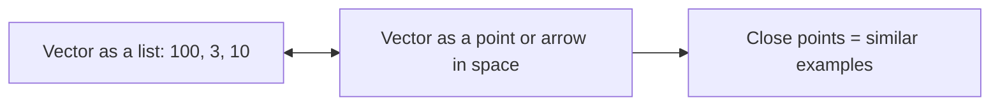

# Lesson 004: Linear Algebra for AI (Part 1)

**Stage:** 1 (Beginner)  |  **Module:** 1.4  |  **Estimated time:** 5 to 7 hours  |  **Prerequisites:** Lessons 001 to 003 (learning loop, NumPy arrays, shapes, dot product)

**Where we are:** In Lesson 003 you met the dot product and NumPy arrays. This lesson explains *why* they matter. Linear algebra is the language in which AI is written: data is stored as vectors and matrices, a neural network layer is a matrix multiplication, and word meanings are positions in a vector space. We start from simple numbers, do every calculation by hand first, then confirm in NumPy.

**A note on scope:** Linear algebra is a big subject. This lesson (Part 1) covers what you need for neural networks, embeddings, and the security topics ahead: vectors, dot product, length and distance, cosine similarity, matrices, matrix multiplication, and a neural network layer. Transpose details, inverses, eigenvectors, and SVD/PCA come later, exactly when we need them, so you never learn math you cannot yet use.

**No fear:** Everything here is multiplication and addition. If an equation looks scary, find the numeric example right under it first.

---

## 1. Topic Introduction

**What is linear algebra?** The mathematics of **lists of numbers** (vectors) and **grids of numbers** (matrices) and the operations you can perform on them.

**Why it matters for AI:**

| AI concept | How linear algebra shows up |
| --- | --- |
| A data example (a house, an email, a login) | A **vector** of features |
| A whole dataset | A **matrix** (one row per example) |
| A neuron | A **dot product** plus a bias |
| A neural network layer | A **matrix multiplication** |
| A photo | A **3-D array** (height x width x color channels) |
| A word's meaning in an LLM | A **vector** (an embedding) |
| "These two texts are similar" | A **cosine similarity** between vectors |
| GPUs | Hardware built to multiply matrices very fast |

**Why it matters for security:**

- Adversarial examples are small changes to an input *vector*, and their size is measured with **norms** (Section 3.3).
- Vector databases and RAG systems rely on **similarity between vectors**, which attackers can try to manipulate.
- Model weights are just matrices, so stealing, tampering with, or backdooring a model means reading or editing arrays.
- Shape and numeric bugs cause crashes and denial of service in model-serving code.

**What you will learn:**

1. Scalars, vectors, matrices, tensors.
2. Vector addition, scaling, and the dot product (algebra and geometry).
3. Length (norm), distance, and cosine similarity.
4. Matrix-vector and matrix-matrix multiplication, with shape rules.
5. A neural network layer, built by hand and in NumPy.
6. How a matrix transforms space.
7. Two small security labs: a perturbation attack on a linear model, and extracting a linear model through queries.

---

## 2. Fundamental Concepts

### 2.1 The four building blocks

| Object | What it is | Example | NumPy shape |
| --- | --- | --- | --- |
| **Scalar** | A single number | 7 | `()` |
| **Vector** | A list of numbers | \[3, 4\] | `(2,)` |
| **Matrix** | A grid of numbers (rows and columns) | \[\[1, 2, 3\], \[4, 5, 6\]\] | `(2, 3)` |
| **Tensor** | A grid with any number of dimensions (a stack of matrices, and so on) | A batch of color images | `(32, 224, 224, 3)` |

"Tensor" is just the general word. A scalar, vector, and matrix are tensors with 0, 1, and 2 dimensions. PyTorch and TensorFlow are named after them.

### 2.2 Two ways to picture a vector

Both pictures are correct and useful. Learn to switch between them.

**Picture 1: a list of features (the data view).** A house is described by \[size in m2, number of rooms, age in years\] = \[100, 3, 10\]. That list *is* the vector. A dataset of 1,000 houses is a matrix with 1,000 rows and 3 columns.

**Picture 2: an arrow or a point in space (the geometric view).** The vector \[3, 4\] is an arrow from the origin to the point 3 steps right and 4 steps up. With 3 numbers you get a point in 3-D space. A house is a point in 3-D "feature space". A word embedding with 768 numbers is a point in a 768-dimensional space. You cannot picture 768 dimensions, but the math works the same as in 2-D, so we build our intuition in 2-D and trust it to scale up.



**The key idea:** *similar things are close together in vector space.* That one sentence underlies classification, clustering, recommendation, embeddings, and vector search.

---

## 3. Technical Explanation

### 3.1 Vector addition and scaling

**Addition:** add matching positions.

```latex
[3, 4] + [1, 2] = [3+1,\ 4+2] = [4, 6]
```

**Scalar multiplication:** multiply every position by the same number.

```latex
2 \times [3, 4] = [6, 8]
```

Geometrically, adding vectors means walking along one arrow, then along the other. Multiplying by 2 stretches the arrow to twice the length in the same direction; multiplying by -1 flips it around.

Both operations require vectors of the **same length**. Adding a 3-number vector to a 2-number vector is meaningless (NumPy raises an error, except for the broadcasting cases you learned in Lesson 003).

These two operations power **gradient descent** from Lesson 002: `w = w - lr * grad` is a vector subtraction and a scaling, performed on a vector with one number per parameter.

### 3.2 The dot product

The most important operation in this course. Multiply matching positions, then add everything up.

```latex
a \cdot b = a_1 b_1 + a_2 b_2 + \dots + a_n b_n
```

**Numeric example.** a = \[3, 4\], b = \[1, 2\]:

- 3 x 1 = 3
- 4 x 2 = 8
- Sum: **11**

The result is a **single number** (a scalar), not a vector.

**Meaning 1: a weighted sum (the data view).** Suppose a house has features x = \[100, 3, 10\] (size, rooms, age) and a model has weights w = \[2.0, 5.0, -1.0\] and a bias b = 20:

```latex
\hat{y} = w \cdot x + b = (2.0)(100) + (5.0)(3) + (-1.0)(10) + 20 = 200 + 15 - 10 + 20 = 225
```

Each weight says how much its feature matters: size adds 2 per unit, each room adds 5, each year of age subtracts 1. **This is exactly what a neuron computes.** A neuron is a dot product of inputs and weights, plus a bias (and then, usually, an activation function we add in Stage 2).

**Meaning 2: how aligned two vectors are (the geometric view).** The dot product also equals:

```latex
a \cdot b = \|a\|\,\|b\|\,\cos\theta
```

where the double bars mean the vector's length (next section) and theta is the angle between the vectors. So:

| Dot product | Angle | Meaning |
| --- | --- | --- |
| Large positive | Small angle | Vectors point the same way (aligned) |
| Zero | 90 degrees | Perpendicular (**orthogonal**): unrelated directions |
| Large negative | Close to 180 degrees | Vectors point in opposite directions |

Check: \[1, 0\] and \[0, 1\] point along the two axes at 90 degrees, and 1 x 0 + 0 x 1 = **0**.

### 3.3 Length (norm) and distance

**The norm** of a vector is its length. The most common is the **L2 norm** (the ordinary straight-line length, from Pythagoras):

```latex
\|a\|_2 = \sqrt{a_1^2 + a_2^2 + \dots + a_n^2}
```

**Example:** a = \[3, 4\]. Length = sqrt(3 squared + 4 squared) = sqrt(9 + 16) = sqrt(25) = **5**. (The classic 3-4-5 right triangle.)

**Distance** between two vectors is the norm of their difference. a = \[3, 4\], b = \[1, 2\]: a minus b = \[2, 2\], so the distance is sqrt(4 + 4) = sqrt(8) = **2.83**.

There are other norms. You will see all three constantly in adversarial machine learning, where they measure "how big is the change an attacker made?"

| Norm | Formula (in words) | For \[3, -4\] | Meaning |
| --- | --- | --- | --- |
| **L1** | Add up the absolute values | 3 + 4 = **7** | Total amount of change |
| **L2** | Square root of the sum of squares | sqrt(9 + 16) = **5** | Straight-line (Euclidean) size |
| **L-infinity** | The largest absolute value | **4** | The biggest change to any single feature |
| **L0** | Count of non-zero entries | **2** | How many features were changed |

An attacker who is allowed to change each pixel of an image by at most a tiny amount is constrained in **L-infinity**. One who may change only a few pixels, but by any amount, is constrained in **L0**. Keep this table; we will use it in the adversarial ML track.

**Normalization:** dividing a vector by its L2 norm gives a **unit vector** (length 1) pointing the same way. \[3, 4\] divided by 5 = \[0.6, 0.8\], and its length is sqrt(0.36 + 0.64) = 1.

### 3.4 Cosine similarity

If we only care about **direction** (not length), we measure the angle between vectors by rearranging the geometric dot product formula:

```latex
\cos\theta = \frac{a \cdot b}{\|a\|\,\|b\|}
```

**Numeric example.** a = \[3, 4\], b = \[1, 2\]. Dot product = 11. Lengths: 5 and sqrt(5) = 2.236. So cosine similarity = 11 / (5 x 2.236) = 11 / 11.18 = **0.984**.

| Cosine similarity | Meaning |
| --- | --- |
| Close to **1** | Same direction (very similar) |
| Around **0** | Unrelated (perpendicular) |
| Close to **-1** | Opposite |

**Why AI loves it:** In language models, a word, sentence, or document is turned into an **embedding vector**. Texts with similar meaning get vectors pointing in similar directions, so cosine similarity becomes a measure of semantic similarity. Searching a vector database is, at heart, "find the stored vectors with the highest cosine similarity to my query vector." This is the engine of **RAG** (Stage 2).

### 3.5 Matrices

A **matrix** is a grid of numbers. Its **shape** is written (rows, columns). This matrix has shape (2, 3):

```
    col0 col1 col2
row0 [ 1    2    3 ]
row1 [ 4    5    6 ]
```

Two ways to read a matrix:

- **As a dataset:** each **row** is one example, each **column** is one feature. A matrix with 1,000 rows and 3 columns is 1,000 houses with 3 features each.
- **As a bundle of weights:** each column (or row, depending on convention) holds the weights of one neuron. A layer of 16 neurons is one matrix.

**The transpose** flips rows and columns. The transpose of a (2, 3) matrix is a (3, 2) matrix. In NumPy: `A.T`. Row 0 of A becomes column 0 of A.T.

### 3.6 Matrix times vector

Take a matrix and a vector. **Each row of the matrix is dot-multiplied with the vector**, producing one number per row.

```latex
\begin{bmatrix} 1 & 2 & 3 \\ 4 & 5 & 6 \end{bmatrix}
\begin{bmatrix} 1 \\ 0 \\ 2 \end{bmatrix}
=
\begin{bmatrix} 1\cdot1 + 2\cdot0 + 3\cdot2 \\ 4\cdot1 + 5\cdot0 + 6\cdot2 \end{bmatrix}
=
\begin{bmatrix} 7 \\ 16 \end{bmatrix}
```

Step by step: row 0 is \[1, 2, 3\], vector is \[1, 0, 2\]. Dot product = 1 + 0 + 6 = **7**. Row 1 is \[4, 5, 6\]. Dot product = 4 + 0 + 12 = **16**. Result: \[7, 16\].

**Shape rule:** (2, 3) times (3,) gives (2,). The inner numbers (3 and 3) must match, and they disappear. The result has the outer numbers.

**Why this matters:** a matrix-vector product is *many dot products at once*. If each row holds one neuron's weights, then one matrix-vector multiplication computes the output of **every neuron in a layer** for one input.

### 3.7 Matrix times matrix

Multiplying two matrices is just repeating the matrix-vector product for each column of the second matrix. The entry in row i, column j of the result is the **dot product of row i of the first matrix with column j of the second**.

**Example:** A is (2, 2), B is (2, 2).

```latex
\begin{bmatrix} 1 & 2 \\ 3 & 4 \end{bmatrix}
\begin{bmatrix} 0 & 1 \\ 1 & 0 \end{bmatrix}
=
\begin{bmatrix} 1\cdot0+2\cdot1 & 1\cdot1+2\cdot0 \\ 3\cdot0+4\cdot1 & 3\cdot1+4\cdot0 \end{bmatrix}
=
\begin{bmatrix} 2 & 1 \\ 4 & 3 \end{bmatrix}
```

(Notice B swapped the columns of A. Matrices *do* things to other matrices.)

**The shape rule (memorize this):**

```latex
(m \times n)\ \cdot\ (n \times p)\ =\ (m \times p)
```

The two **inner** dimensions (n and n) must be equal. The **outer** dimensions (m and p) give the result's shape. If the inner dimensions differ, multiplication is impossible and NumPy raises an error. Most shape bugs in AI code are violations of this single rule.

**Order matters:** AB is generally **not** equal to BA. Matrix multiplication is not commutative. (Try it with the example above reversed.)

In NumPy you write `A @ B`. The `*` operator is **element-wise** multiplication, which is a different operation. Mixing them up is a classic beginner bug.

### 3.8 A neural network layer

Now everything connects. A **layer** of a neural network takes input features, mixes them with weights, adds biases, and applies a simple non-linear function. Using the convention that each *row* of the input is one example:

```latex
Z = X W + b \qquad A = \mathrm{ReLU}(Z)
```

| Symbol | Meaning | Shape |
| --- | --- | --- |
| **X** | A batch of inputs, one example per row | (batch, features) |
| **W** | Weights, one column per neuron | (features, neurons) |
| **b** | Biases, one per neuron | (neurons,) |
| **Z** | Raw outputs of every neuron for every example | (batch, neurons) |
| **ReLU** | "Rectified linear unit": replaces negatives with 0, keeps positives | same as Z |

Why do we need ReLU (an **activation function**)? Without it, stacking layers collapses: a matrix multiplied by another matrix is just one bigger matrix, so ten linear layers are no more powerful than one. The non-linear activation is what lets deep networks learn complicated patterns. We will study activations properly in the neural network lesson.

**Stacking layers** means feeding one layer's output into the next: A1 = ReLU(X W1 + b1), then output = A1 W2 + b2. That is a two-layer neural network. **The entire forward pass of a neural network is a chain of matrix multiplications with simple functions in between.** Everything in LLMs, including attention, is built from the same ingredients (with some extra bookkeeping).

**Counting parameters:** a layer from 8 features to 16 neurons has 8 x 16 = 128 weights plus 16 biases = **144 parameters**. These are the numbers gradient descent adjusts.

### 3.9 What a matrix does to space (geometric intuition)

A matrix multiplication is a **transformation**: it moves, stretches, or rotates every point. Two examples in 2-D:

```latex
\begin{bmatrix} 0 & -1 \\ 1 & 0 \end{bmatrix}\begin{bmatrix} 1 \\ 0 \end{bmatrix} = \begin{bmatrix} 0 \\ 1 \end{bmatrix}
\qquad
\begin{bmatrix} 2 & 0 \\ 0 & 3 \end{bmatrix}\begin{bmatrix} 1 \\ 1 \end{bmatrix} = \begin{bmatrix} 2 \\ 3 \end{bmatrix}
```

The first matrix **rotates** the point (1, 0) by 90 degrees to (0, 1). The second **stretches** x by 2 and y by 3. A trained layer learns a transformation that moves data into a space where the task becomes easy, for instance where spam and non-spam sit on opposite sides of a dividing line. Each layer reshapes the space a little.

---

## 4. Important Terminology

| Term | Definition |
| --- | --- |
| **Scalar / vector / matrix / tensor** | 0-D / 1-D / 2-D / n-D grids of numbers |
| **Dimension (of a vector)** | How many numbers it contains |
| **Shape** | The size along each axis, e.g. (2, 3) |
| **Dot product** | Multiply matching entries and add: a single number |
| **Norm** | The length (size) of a vector; L0, L1, L2, L-infinity are common types |
| **Unit vector** | A vector with L2 norm 1 |
| **Distance** | The norm of the difference between two vectors |
| **Cosine similarity** | The cosine of the angle between two vectors; measures direction similarity |
| **Orthogonal** | Perpendicular; dot product equals zero |
| **Transpose (A.T)** | The matrix with rows and columns swapped |
| **Matrix multiplication (`@`)** | Dot products of rows with columns; needs matching inner dimensions |
| **Element-wise product (`*`)** | Multiply matching positions with no summing |
| **Weights / bias** | Learned multipliers / learned offset in a layer |
| **Layer** | A group of neurons: Z = XW + b followed by an activation |
| **Activation function** | A non-linear function (e.g. ReLU) applied after the linear part |
| **Batch** | A group of examples processed together (the rows of X) |
| **Feature space / embedding space** | The space whose axes are the vector's entries |
| **Embedding** | A vector that represents something (a word, sentence, image) |
| **Forward pass** | Computing the network's output from its input |

Add these to your `glossary.md`.

---

## 5. Step-by-Step Example: A Layer on a Batch, By Hand

A layer takes 2 features and has 3 neurons. We feed in a batch of 2 examples.

```
X (2 examples x 2 features)      W (2 features x 3 neurons)      b (3 biases)
[[1, 2],                         [[1, 0, -1],                    [0, 1, -1]
 [3, 4]]                          [2, 1,  0]]
```

**Step 1: Shape check.** X is (2, 2), W is (2, 3). Inner dimensions 2 and 2 match, so X @ W exists and has shape (2, 3).

**Step 2: Multiply (row of X dot column of W).**

Example 1, X row = \[1, 2\]:

- Neuron 1 (column \[1, 2\]): 1 x 1 + 2 x 2 = **5**
- Neuron 2 (column \[0, 1\]): 1 x 0 + 2 x 1 = **2**
- Neuron 3 (column \[-1, 0\]): 1 x -1 + 2 x 0 = **-1**

Example 2, X row = \[3, 4\]:

- Neuron 1: 3 x 1 + 4 x 2 = **11**
- Neuron 2: 3 x 0 + 4 x 1 = **4**
- Neuron 3: 3 x -1 + 4 x 0 = **-3**

So X @ W = \[\[5, 2, -1\], \[11, 4, -3\]\].

**Step 3: Add the bias** to every row (broadcasting, from Lesson 003): add \[0, 1, -1\].

Z = \[\[5, 3, -2\], \[11, 5, -4\]\].

**Step 4: ReLU** (negatives become 0): A = \[\[5, 3, 0\], \[11, 5, 0\]\].

That is a full layer computation. A real network does the same thing with matrices of thousands of rows and columns; a GPU performs those dot products in parallel.

---

## 6. Practical Demonstration

Activate your `.venv` (NumPy is already installed). Create each script, run it, and compare with the hand calculations.

### 6.1 Vectors, norms, and cosine similarity

```python
# lesson004_vectors.py
import numpy as np

a = np.array([3.0, 4.0])
b = np.array([1.0, 2.0])

print('a + b       =', a + b)                       # [4. 6.]   element-wise addition
print('2 * a       =', 2 * a)                       # [6. 8.]   scaling
print('a . b       =', a @ b)                       # 11.0      dot product (3*1 + 4*2)

print('L2 norm of a      =', np.linalg.norm(a))           # 5.0
print('L1 norm of a      =', np.linalg.norm(a, 1))        # 7.0
print('L-inf norm of a   =', np.linalg.norm(a, np.inf))   # 4.0
print('distance a to b   =', np.linalg.norm(a - b))       # 2.828...

def cosine(u, v):
    return (u @ v) / (np.linalg.norm(u) * np.linalg.norm(v))   # dot product over lengths

print('cosine(a, b) =', cosine(a, b))               # about 0.984
print('cosine of perpendicular vectors:', cosine(np.array([1.0, 0.0]), np.array([0.0, 1.0])))   # 0.0
print('cosine of opposite vectors:    ', cosine(a, -a))   # -1.0
```

**What to check:** every printed value should match the hand calculations in Sections 3.1 to 3.4. If one does not, find your mistake before moving on; this is how you build real understanding.

### 6.2 Matrices and layers

```python
# lesson004_matrix.py
import numpy as np

# --- Matrix times vector (Section 3.6) ---
A = np.array([[1, 2, 3],
              [4, 5, 6]])
v = np.array([1, 0, 2])
print('A @ v =', A @ v)                    # [ 7 16]

# --- Matrix times matrix (Section 3.7) ---
P = np.array([[1, 2], [3, 4]])
Q = np.array([[0, 1], [1, 0]])
print('P @ Q =\n', P @ Q)                 # [[2 1] [4 3]]
print('Q @ P =\n', Q @ P)                 # different! order matters
print('P * Q (element-wise) =\n', P * Q)  # a different operation entirely

# --- The layer from Section 5 ---
X = np.array([[1.0, 2.0], [3.0, 4.0]])
W = np.array([[1.0, 0.0, -1.0], [2.0, 1.0, 0.0]])
b = np.array([0.0, 1.0, -1.0])

Z = X @ W + b                            # linear part: matrix multiply, then add bias (broadcast)
A_out = np.maximum(0, Z)                 # ReLU: keep the larger of 0 and each value
print('Z =\n', Z)                         # [[ 5.  3. -2.] [11.  5. -4.]]
print('ReLU(Z) =\n', A_out)              # [[ 5.  3.  0.] [11.  5.  0.]]

# --- Geometry: rotation and stretching (Section 3.9) ---
R = np.array([[0, -1], [1, 0]])          # 90-degree rotation matrix
print('rotate (1,0):', R @ np.array([1, 0]))        # [0 1]
S = np.array([[2, 0], [0, 3]])           # stretching matrix
print('stretch (1,1):', S @ np.array([1, 1]))       # [2 3]

# --- A shape error on purpose ---
try:
    np.ones((4, 8)) @ np.ones((7, 16))   # inner dimensions 8 and 7 do not match
except ValueError as e:
    print('ValueError:', e)              # read the message: it names the mismatched sizes
```

### 6.3 A two-layer network forward pass

```python
# lesson004_forward.py
import numpy as np

rng = np.random.default_rng(0)           # seeded generator: reproducible

batch, n_in, n_hidden, n_out = 4, 8, 16, 3

X  = rng.normal(size=(batch, n_in))               # 4 random examples with 8 features each
W1 = rng.normal(size=(n_in, n_hidden)) * 0.1      # layer 1 weights (8 -> 16), kept small
b1 = np.zeros(n_hidden)                           # layer 1 biases
W2 = rng.normal(size=(n_hidden, n_out)) * 0.1     # layer 2 weights (16 -> 3)
b2 = np.zeros(n_out)

H = np.maximum(0, X @ W1 + b1)           # hidden layer: matrix multiply, bias, ReLU
out = H @ W2 + b2                        # output layer: matrix multiply, bias

print('X shape:  ', X.shape)             # (4, 8)
print('H shape:  ', H.shape)             # (4, 16)
print('out shape:', out.shape)           # (4, 3): 3 scores for each of the 4 examples
n_params = W1.size + b1.size + W2.size + b2.size
print('parameters:', n_params)          # 8*16 + 16 + 16*3 + 3 = 195
```

The weights here are random, so the outputs are meaningless. Learning would adjust all 195 numbers by gradient descent to make the outputs useful. **Only the shapes and the flow matter in this exercise.** Trace every shape by hand before you run it.

### 6.4 Mini project: similarity search with toy embeddings

Real embeddings have hundreds or thousands of dimensions and come from a trained model. To learn the mechanics, we use **small invented 3-number embeddings** (made up for teaching; they are not from any real model).

```python
# lesson004_search.py
import numpy as np

embeddings = {                           # invented vectors: [royalty-ness, person-ness, fruit-ness]
    'king':   np.array([0.90, 0.80, 0.10]),
    'queen':  np.array([0.85, 0.75, 0.20]),
    'prince': np.array([0.80, 0.85, 0.10]),
    'apple':  np.array([0.10, 0.20, 0.95]),
    'banana': np.array([0.15, 0.10, 0.90]),
    'car':    np.array([0.30, 0.10, 0.10]),
}

def cosine(u, v):
    return (u @ v) / (np.linalg.norm(u) * np.linalg.norm(v))

def search(query_vec, k=3):
    scored = [(word, cosine(query_vec, vec)) for word, vec in embeddings.items()]
    scored.sort(key=lambda pair: pair[1], reverse=True)   # highest similarity first
    return scored[:k]

for q in ['king', 'apple']:
    print(f'closest to {q}:')
    for word, score in search(embeddings[q]):
        print(f'   {word:7s} {score:.3f}')
```

**Expected:** the closest word to each query is itself (similarity 1.000), then its semantic neighbors: queen and prince for king; banana for apple. This is a miniature vector database. Real RAG systems do the same comparison across millions of stored vectors, usually with fast approximate search.

**Troubleshooting**

| Problem | Fix |
| --- | --- |
| `ValueError: matmul: Input operand 1 has a mismatch in its core dimension` | Inner dimensions differ. Print `.shape` of both arrays |
| Results look wrong but no error | Check you used `@` (matrix multiply), not `*` (element-wise) |
| Integer results where you expected decimals | Use floats (`1.0`) or `dtype=float` |
| Slightly different last digits | Floating point rounding; compare with `np.isclose`, not `==` |

### 6.5 Security lab A: why tiny changes can flip a model (toy linear model)

**Learning objective:** See with your own eyes why high-dimensional models are fragile: a perturbation that is tiny in *every feature* can have a huge total effect. This is the core intuition behind adversarial examples (Goodfellow, Shlens and Szegedy, 2014 explain it this way for linear models).

**Safety:** this is a toy linear model on random numbers in your own script. No real system is involved.

The model's score is the dot product of weights w and input x. If the score is positive we say "class A", otherwise "class B". An attacker with the L-infinity budget epsilon may change each feature by at most epsilon. The best direction to push a linear score is **the sign of each weight** (push each feature the way its weight points).

```python
# lesson004_perturb.py   (toy model, local only)
import numpy as np

rng = np.random.default_rng(0)
eps = 0.01                                   # tiny change allowed per feature

print(f'{"dim":>8} {"score change":>14} {"eps*sum|w|":>12} {"eps needed to flip":>20}')
for d in [10, 1000, 100000]:
    w = rng.normal(size=d)                   # the model's weights
    x = rng.normal(size=d)                   # one input
    score = w @ x                            # original score

    x_adv = x + eps * np.sign(w)             # change EVERY feature by exactly +/- eps
    change = w @ x_adv - score               # how much the score moved
    predicted = eps * np.abs(w).sum()        # theory: change = eps * (L1 norm of w)

    eps_flip = abs(score) / np.abs(w).sum()  # smallest eps that is enough to flip the decision
    x_flip = x - 1.01 * eps_flip * np.sign(w) * np.sign(score)   # push against the current sign
    assert np.sign(w @ x_flip) != np.sign(score)                 # confirm the decision flipped
    print(f'{d:8d} {change:14.4f} {predicted:12.4f} {eps_flip:20.5f}')
```

**Expected (approximately, since the numbers are random):**

- The measured score change equals `eps * sum|w|` (the two columns agree), because each feature moved by exactly eps in the most harmful direction.
- The score change **grows roughly in proportion to the number of dimensions**, even though each feature moved by only 0.01.
- The epsilon needed to flip the decision **shrinks as dimension grows** (very roughly like 1 divided by the square root of d). With 100,000 features, a change of a few thousandths per feature can flip it.

**Security lessons:**

1. High dimensionality is a vulnerability amplifier: many tiny changes add up.
2. The attacker's best move comes straight from the model's weights (or gradient): the **sign of the gradient** with respect to the input. For a linear model the gradient of the score with respect to x is just w. This is the idea behind the famous Fast Gradient Sign Method, which we will study properly in the adversarial ML track.
3. The size of the perturbation is measured with a **norm**: here, L-infinity.
4. Real deep networks are not linear, but this linear intuition explains much of why they are vulnerable.

### 6.6 Security lab B: extracting a linear model through queries

**Learning objective:** Understand **model extraction**: an attacker who can query a prediction API can sometimes reconstruct the model. For a linear model, high-school algebra is enough (the idea appears for real model families in Tramer et al., 2016, "Stealing Machine Learning Models via Prediction APIs").

```python
# lesson004_extract.py   (toy 'API' you control, local only)
import numpy as np

# ---- The 'victim': a secret linear model behind an API ----
secret_w = np.array([2.0, -1.0, 0.5])
secret_b = 3.0
def api(x):                                   # attacker can only call this and see the number returned
    return secret_w @ x + secret_b

# ---- The attacker: only uses queries ----
d = 3
b_hat = api(np.zeros(d))                      # query the all-zero input: result is just the bias
w_hat = np.array([api(e) - b_hat for e in np.eye(d)])   # query each unit vector, subtract the bias

print('recovered w:', w_hat)                  # [ 2. -1.  0.5]
print('recovered b:', b_hat)                  # 3.0
print('queries used:', d + 1)
print('exact match:', np.allclose(w_hat, secret_w) and np.isclose(b_hat, secret_b))
```

**What happened:** `np.eye(3)` is the identity matrix, whose rows are the unit vectors \[1,0,0\], \[0,1,0\], \[0,0,1\]. Querying a unit vector returns weight\_i plus the bias. Subtracting the bias (from the zero query) isolates each weight. A linear model with d features has d + 1 unknowns, so about **d + 1 queries** reveal it exactly.

**Security lessons:**

1. Exposing exact scores gives attackers a lot of information. Real systems are non-linear and larger, but extraction attacks exist for them too and need more queries.
2. Common defenses: rate limiting and query monitoring, returning only labels (not scores), rounding or limiting confidence output, and watermarking. Each defense has costs and none is perfect; we study them in the model extraction lesson.
3. A stolen model is also easier to attack: the attacker can compute gradients on their own copy and transfer the adversarial inputs to the original.

---

## 7. Real-World Applications

| Linear algebra idea | Real use |
| --- | --- |
| Dot product | Every neuron; scoring in recommendation and ranking; attention scores in transformers |
| Cosine similarity | Semantic search, RAG retrieval, duplicate detection, clustering similar malware samples by feature vectors |
| Matrix multiplication | Every layer of every neural network; GPUs and TPUs are built to accelerate it |
| Norms and distance | k-nearest neighbors, anomaly detection (distance from normal), measuring adversarial perturbation size |
| Embeddings | Word, sentence, image, and code representations; vector databases |
| Linear transformations | Image rotation and scaling, data compression, dimensionality reduction (PCA) |
| Tensors | Images, video, audio, batches of text tokens |

---

## 8. Cybersecurity Perspective

| Topic | Connection to linear algebra | Where we go deeper |
| --- | --- | --- |
| **Adversarial examples (evasion)** | An adversary adds a small perturbation vector to the input; its size is bounded in a norm (L0, L2, L-infinity). The gradient gives the direction | Adversarial ML track |
| **Model extraction** | Repeated queries give equations; enough equations reveal the weights (Lab B) | Adversarial ML track |
| **Embedding and vector-database attacks** | Retrieval ranks by cosine similarity, so an attacker who can add documents may craft text whose embedding is close to likely queries, to get it retrieved (a form of RAG poisoning). Conceptual here only | RAG security |
| **Model tampering and backdoors** | Weights are matrices in files. Changing a small number of entries or inserting a trigger-response pattern changes behavior while overall accuracy looks normal | Backdoor and supply-chain lessons |
| **Model file safety** | Weight files are arrays, but some formats can also carry executable code (pickle risk, Lesson 003). Prefer array-only formats | AI supply chain |
| **Numerical and shape attacks** | Unvalidated input shapes, huge values, NaN or infinity can crash a serving process or poison downstream calculations | LLM and API testing |
| **Embedding privacy** | Embeddings can leak information about the data they encode | Privacy attacks (inversion, membership inference) |
| **Precision tricks** | Reduced precision (quantization) changes the matrices slightly; robustness can change with it | Model compression security |

**Defender's takeaway:** knowing the norm that bounds the attacker, the shape of the data flowing through the system, and the exact similarity function used in retrieval gives you a precise way to describe and test threats.

---

## 9. Common Mistakes and Misconceptions

| Mistake | Reality / fix |
| --- | --- |
| Using `*` when you need `@` | `*` is element-wise; `@` is matrix multiplication |
| Assuming AB = BA | Matrix multiplication is not commutative |
| Forgetting the shape rule | Inner dimensions must match: (m, n) @ (n, p) |
| Confusing shape (3,) with (3, 1) | A 1-D vector and a column matrix behave differently; print `.shape` |
| "The dot product is a vector" | It is a single number |
| "Cosine similarity measures length" | It ignores length; it measures direction only |
| "Dot product and cosine similarity are the same" | Cosine divides by both lengths; dot product grows with vector length |
| "More dimensions are always better" | More dimensions cost memory and compute and can add vulnerability and noise |
| "Small perturbations are harmless" | In high dimensions, many tiny changes add up (Lab A) |
| "Stacked linear layers are more powerful" | Without non-linear activations they collapse into one matrix |
| Comparing floats with `==` | Use `np.isclose` or `np.allclose` |
| "Matrices are only for experts" | You have just done every operation by hand with small numbers |

---

## 10. Key Takeaways

- **Data are vectors; datasets are matrices; images and batches are tensors.**
- **Similar things are close in vector space.** Distance and cosine similarity measure how close.
- The **dot product** is a weighted sum: it is a neuron, and it is also a measure of alignment.
- **Norms** (L0, L1, L2, L-infinity) measure size, and they define how adversarial perturbations are bounded.
- **Matrix multiplication** is many dot products at once. Shape rule: (m, n) @ (n, p) = (m, p).
- A **layer** is `Z = X @ W + b` followed by a non-linear activation; a network is layers chained together. Parameter count = weights + biases.
- A matrix **transforms space** (rotates, stretches); layers reshape data until the task becomes easy.
- Security: perturbations are vectors with a size, high dimensions amplify small changes, query access can leak a model, and weights are arrays that can be tampered with.

---

## 11. Exercises

**Exercise 1 (dot product).** By hand, compute a . b for a = \[2, -1, 3\] and b = \[4, 0, 5\]. Then compute the L2 norms of both vectors and the cosine similarity (leave square roots unsimplified, then give a decimal). Confirm with NumPy.

**Exercise 2 (orthogonal).** Find the value of x that makes \[x, 2\] perpendicular to \[3, -1\]. Verify by computing the dot product.

**Exercise 3 (norms).** For the vector \[6, -8, 0\], compute the L0, L1, L2, and L-infinity norms by hand. Which one would you use to describe "the attacker changed only 2 features"? Which for "no feature changed by more than 8"?

**Exercise 4 (cosine).** Compute the cosine similarity of \[1, 1\] and \[1, 0\] by hand. What angle does that correspond to? (Think about where each vector points.)

**Exercise 5 (matrix times vector).** By hand: multiply the matrix \[\[2, 1\], \[0, 3\], \[-1, 4\]\] by the vector \[2, 1\]. What are the input shape, matrix shape, and output shape?

**Exercise 6 (shape rule).** For each pair, say whether `A @ B` is valid and give the result shape if it is: (a) (5, 3) @ (3, 2); (b) (5, 3) @ (5, 3); (c) (1, 4) @ (4, 1); (d) (4, 1) @ (1, 4); (e) (10, 784) @ (784, 128).

**Exercise 7 (a layer by hand).** Invent a 3-example, 2-feature input X (numbers between -3 and 3), a (2, 2) weight matrix W, and a 2-element bias b. Compute `ReLU(X @ W + b)` by hand, then check it in NumPy. Write down every intermediate shape.

**Exercise 8 (counting parameters).** A network has layers 784 -> 128 -> 64 -> 10 (inputs, two hidden layers, outputs). Compute the number of weights and biases in each layer and the total. Then build it with random weights in NumPy and verify with `.size`.

**Exercise 9 (similarity search).** Extend `lesson004_search.py`: add two new words with invented embeddings (include one that is deliberately in between two groups). Query with a vector you invent (for example \[0.5, 0.5, 0.5\]) and explain the ranking. What happens if you query with the zero vector? (Why does cosine similarity break down?)

**Exercise 10 (Lab A).** Run `lesson004_perturb.py`. Make a table of dimension against epsilon needed to flip. Then try an **L2-bounded** attacker: for a budget of L2 size r, the best direction is `w / np.linalg.norm(w)`, and the score change is `r * np.linalg.norm(w)`. Compare how large r and eps must be to flip the decision. Which budget notion feels more "stealthy" to you, and why?

**Exercise 11 (Lab B).** Extend `lesson004_extract.py` to 5 features. Confirm it needs 6 queries. Then change `api` so that it returns the score **rounded to 1 decimal place**. Does extraction still work exactly? How close can you get? Write three sentences on what rounding does as a defense and what it costs legitimate users.

**Exercise 12 (teach it back).** Explain to a non-technical friend why "a neural network layer is a matrix multiplication" in 6 to 8 sentences, using an analogy of your own.

---

## 12. Knowledge Assessment

1. What is the difference between a scalar, a vector, a matrix, and a tensor? Give a shape for each.
2. Give two interpretations of what a vector can represent.
3. Compute \[1, 2, 3\] . \[4, -5, 6\] by hand.
4. What does it mean when the dot product of two vectors is zero? Positive and large? Negative?
5. Why is the dot product of inputs and weights called "a neuron"?
6. Compute the L1, L2, and L-infinity norms of \[-2, 3, -6\].
7. What is the difference between the dot product and cosine similarity? When would you prefer cosine similarity?
8. State the shape rule for matrix multiplication. Can a (3, 4) matrix be multiplied by a (3, 4) matrix? Why or why not?
9. What is the difference between `A * B` and `A @ B` in NumPy?
10. Why is AB generally not equal to BA?
11. A layer maps 20 features to 10 neurons. What are the shapes of W and b, and how many parameters does it have?
12. Why do neural networks need activation functions between layers?
13. How does a vector database use cosine similarity? Why does this matter for RAG?
14. In Lab A, why does the same tiny per-feature change have a larger total effect as the number of dimensions grows?
15. Name the norm that bounds "change each pixel by at most 2 levels", and the norm that bounds "change at most 10 pixels by any amount".
16. In Lab B, why can a linear model with d features be recovered with about d + 1 queries? Name two defenses against extraction.
17. *Challenge:* An attacker can add documents to a RAG knowledge base. Using what you know about cosine similarity, describe in general terms why they might try to make a document's embedding close to a likely user query, and how a defender could try to detect it.
18. *Challenge:* A serving API accepts a JSON array of floats and reshapes it into a (1, 784) matrix. List three input-validation checks that would prevent crashes or abuse.

Send me your answers (and any outstanding answers from Lessons 001 to 003) and I will grade them and adapt the next lesson.

---

## Further Reading and References

- 3Blue1Brown, *Essence of Linear Algebra* (free video series): the best visual intuition for vectors, matrices, and transformations. Watch chapters 1 to 4 and 7 now.
- Deisenroth, Faisal, Ong, *Mathematics for Machine Learning* (Cambridge University Press, free PDF at mml-book.com): Chapter 2 (Linear Algebra) is a good reference.
- Strang, *Introduction to Linear Algebra*, and the MIT OpenCourseWare 18.06 lectures (free).
- NumPy documentation: `numpy.linalg`, `numpy.matmul`, broadcasting (numpy.org/doc).
- Goodfellow, Shlens, Szegedy (2014), *Explaining and Harnessing Adversarial Examples*: the linear explanation of adversarial vulnerability (arXiv).
- Tramer et al. (2016), *Stealing Machine Learning Models via Prediction APIs* (USENIX Security).
- OWASP Top 10 for LLM Applications and MITRE ATLAS: look for the entries on model theft, vector and embedding weaknesses, and supply chain, and note how many connect to today's ideas. Check each site for the current version.

---

## Glossary additions (copy into `glossary.md`)

Scalar, vector, matrix, tensor, dimension, shape, dot product, norm (L0, L1, L2, L-infinity), unit vector, distance, cosine similarity, orthogonal, transpose, matrix multiplication, element-wise product, weights, bias, layer, activation function, ReLU, batch, feature space, embedding, forward pass, linear transformation, model extraction, perturbation.

---

## Next Steps

1. Save this document as `notes/stage1-beginner/lesson-004-linear-algebra-1.md`.
2. Do the hand calculations (Exercises 1 to 7) **before** checking with NumPy.
3. Run all scripts and both security labs. Change one number at a time and predict the effect before running.
4. Complete the exercises and assessment, then update `progress.md` with what felt easy, what felt hard, and any questions.

**Lesson 005 preview:** *Mathematics for AI, part 2: Probability and Statistics.* Probability, random variables, mean, variance, standard deviation, the normal distribution, conditional probability and Bayes' rule (which will finally explain how the spam classifier from Lesson 001 works), and why the softmax function turns scores into probabilities. Later lessons add the remaining linear algebra tools (inverses, eigenvectors, SVD and PCA) at the moment each is needed.
