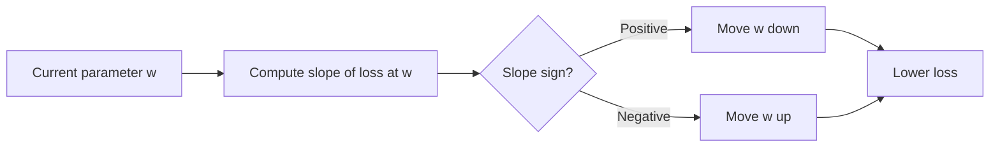
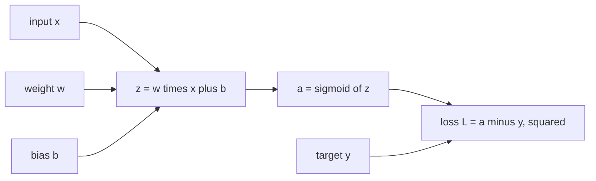

# Lesson 006: Calculus for AI

**Stage:** 1 (Beginner)  |  **Module:** 1.6  |  **Estimated time:** 5 to 7 hours  |  **Prerequisites:** Lessons 001 to 005 (especially gradient descent from 002, vectors from 004, and softmax and cross-entropy from 005)

**Where we are:** In Lessons 002 and 003 you used a gradient formula, and I told you we would derive it later. Today is later. Calculus is the math of **change**: how much does the output of a function move when you nudge its input? That one question is how a model knows which way to adjust every one of its millions of parameters. By the end of this lesson you will be able to derive the gradient formulas yourself, verify any gradient numerically, and run one full step of backpropagation by hand on a tiny network. You will also see how an attacker uses the *same* gradients, pointed at the input instead of the weights.

**No fear:** We start with slopes you can measure with a calculator, then introduce rules as shortcuts. Every formula has a numeric check right next to it. You do **not** need to master integrals, limits, or fancy techniques: only derivatives, the chain rule, and partial derivatives.

---

## 1. Topic Introduction

**What is calculus (for our purposes)?** The tool for answering: *if I change this input by a tiny amount, how much does the output change?* The answer is called a **derivative**. For functions with many inputs, the collection of these answers is the **gradient**.

| AI concept | Calculus idea |
| --- | --- |
| Gradient descent (Lesson 002) | Step opposite the gradient (the slope of the loss) |
| Backpropagation | The **chain rule** applied through every layer |
| Learning rate stability | How steep the loss curve is versus the step size |
| Vanishing and exploding gradients | Products of many derivatives that shrink toward 0 or blow up |
| Softmax with cross-entropy | A beautifully simple gradient (predicted minus actual) |
| Adversarial examples | The gradient of the loss with respect to the **input** |
| PyTorch and TensorFlow `autograd` | Software that applies the chain rule automatically |

**Why it matters for security:**

- Evasion attacks (FGSM, PGD) are gradient computations with respect to the input.
- Attackers who only have query access can **estimate** gradients numerically (the same finite-difference idea you learn today).
- Some "defenses" only hide gradients; understanding gradients shows why that gives false security.
- Gradients can **leak training data** when shared (for example in federated learning).
- Numerical problems in gradients (NaN, overflow) crash training and serving systems.

**What you will learn:**

1. The derivative as a slope, measured numerically.
2. Derivative rules (power, sum, constant multiple) and common derivatives.
3. Gradient descent in one dimension, and why the learning rate can blow up.
4. The chain rule.
5. Partial derivatives and the gradient vector.
6. Deriving the MSE gradient from Lessons 002 and 003.
7. Backpropagation on a tiny network, by hand.
8. Gradient checking, and the softmax and cross-entropy gradient.
9. A security lab: gradient-based evasion of a toy model.

---

## 2. Fundamental Concepts

### 2.1 Slope: how steep is the curve?

For a straight line, the **slope** is rise over run: how much y goes up when x goes right by 1. For a curve, the steepness changes from point to point, so we need the slope *at a particular point*.

Take f(x) = x squared. Let us measure the slope at x = 3 by nudging x a tiny bit:

- f(3) = 9
- f(3.001) = 9.006001
- Change in output: 9.006001 - 9 = 0.006001
- Change in input: 0.001
- Slope estimate: 0.006001 / 0.001 = **6.001**

Smaller nudges give estimates closer to exactly **6**. That limiting value is the **derivative** of x squared at x = 3.

```latex
f'(x) = \lim_{h \to 0} \frac{f(x+h) - f(x)}{h}
```

The notation f'(x) (read "f prime of x") or df/dx means "the derivative of f with respect to x". You can always approximate it by choosing a very small h, which is exactly what we will do in code (it is called a **numerical derivative** or **finite difference**).

### 2.2 What the derivative tells you

| Derivative at a point | Meaning for a loss function |
| --- | --- |
| **Positive** | Loss rises as the input rises; to reduce loss, **decrease** the input |
| **Negative** | Loss falls as the input rises; to reduce loss, **increase** the input |
| **Zero** | Flat spot: a minimum, a maximum, or a saddle point |
| **Large magnitude** | Steep: small changes in input have a big effect |



This is gradient descent from Lesson 002: **w new = w old minus learning rate times slope**. The minus sign handles both cases automatically.

### 2.3 The tangent line picture

The derivative at a point is the slope of the **tangent line**, the straight line that just touches the curve there. Near that point, the curve behaves almost like its tangent line, so:

```latex
f(x + h) \approx f(x) + f'(x)\, h
```

Check with x = 3, h = 0.001: f(3) + 6 x 0.001 = 9.006, close to the true 9.006001. **Calculus lets us predict the effect of a small change without recomputing everything.** This approximation is the entire basis of gradient descent and of adversarial attacks: for a small enough step, the gradient correctly predicts how the loss will change.

---

## 3. Technical Explanation

### 3.1 Derivative rules (shortcuts for exact slopes)

Measuring slopes numerically works but is slow and slightly inexact. Rules give exact formulas.

| Function | Derivative | Quick check |
| --- | --- | --- |
| constant c | 0 | A flat line has slope 0 |
| x | 1 | y = x rises 1 per 1 |
| **x to the power n** | **n times x to the power (n - 1)** | Power rule |
| c times f(x) | c times f'(x) | Constants multiply through |
| f(x) + g(x) | f'(x) + g'(x) | Slopes add |
| e to the x | e to the x | Its own slope |
| ln(x) | 1 / x | Natural log |

**Examples (all verified by the numeric check):**

- f(x) = x squared. Power rule: 2 x to the power 1 = **2x**. At x = 3 the slope is 6. ✓
- f(x) = x cubed. Derivative **3x squared**. At x = 2 the slope is 12.
- f(x) = 3x squared + 2x - 5. Slope = 3(2x) + 2(1) - 0 = **6x + 2**. At x = 1 the slope is 8.
- f(x) = ln(x). Derivative 1/x. At x = 2 the slope is 0.5.

**Sanity check on f(x) = 3x squared + 2x - 5 at x = 1:** f(1) = 0. f(1.001) = 3(1.002001) + 2.002 - 5 = 3.006003 + 2.002 - 5 = 0.008003. Slope estimate = 0.008003 / 0.001 = **8.003**. ✓

### 3.2 Gradient descent in one dimension (and why the learning rate matters)

Minimize the loss L(w) = (w - 3) squared. We can see the minimum is at w = 3, but pretend we cannot. The derivative is L'(w) = **2(w - 3)** (power rule with the inside treated as one block; the chain rule below justifies this).

Start at w = 0 with learning rate 0.1:

| Step | w | Slope 2(w - 3) | New w = w - 0.1 x slope |
| --- | --- | --- | --- |
| 0 | 0.000 | -6.000 | 0.600 |
| 1 | 0.600 | -4.800 | 1.080 |
| 2 | 1.080 | -3.840 | 1.464 |
| 3 | 1.464 | -3.072 | 1.771 |

The slope shrinks as we approach the bottom, so the steps shrink too, and w creeps toward 3.

**Why too large a learning rate explodes.** One update gives: new w - 3 = (w - 3) minus lr x 2(w - 3) = **(1 - 2 x lr) times (w - 3)**. The distance from the minimum is multiplied by (1 - 2 lr) each step:

| Learning rate | Multiplier (1 - 2 lr) | Behavior |
| --- | --- | --- |
| 0.1 | 0.8 | Smooth convergence |
| 0.5 | 0 | Lands on the minimum in one step |
| 0.9 | -0.8 | Overshoots each time, but the distance shrinks: converges with oscillation |
| 1.0 | -1 | Bounces forever between two points |
| 1.1 | -1.2 | Distance **grows**: divergence |

So the stable range is 0 < lr < 1 for this loss. In Lesson 002 the loss was steeper (the curve was narrower), so its stable range was smaller (it exploded at lr = 0.25). **Steeper curves need smaller steps.** You will confirm this in code.

### 3.3 The chain rule

Most functions in AI are **compositions**: the output of one function feeds into the next. A neural network is a long chain: input, then layer 1, then layer 2, and so on, then loss. The chain rule tells us how to differentiate such a chain.

If y = f(u) and u = g(x), then:

```latex
\frac{dy}{dx} = \frac{dy}{du} \cdot \frac{du}{dx}
```

In words: **the overall rate of change is the product of the rates of change of each link.** If u changes 3 times as fast as x, and y changes twice as fast as u, then y changes 3 x 2 = 6 times as fast as x.

**Example.** y = (3x + 1) squared. Let u = 3x + 1, so y = u squared.

- dy/du = 2u
- du/dx = 3
- dy/dx = 2u x 3 = **6(3x + 1)**

At x = 1: u = 4, so dy/dx = 6 x 4 = **24**. Numeric check: y(1) = 16 and y(1.001) = (4.003) squared = 16.024009, so the slope estimate is 0.024009 / 0.001 = **24.009**. ✓

**Longer chains just multiply more factors.** For y = f(g(h(x))): dy/dx = f' times g' times h', each evaluated at the right place.

**Analogy: blame assignment.** Imagine an assembly line where the final product is defective. The chain rule is how you work backward, station by station, to figure out how much each station's setting contributed to the defect. Backpropagation does exactly this for a neural network.

### 3.4 Partial derivatives and the gradient

Most loss functions have **many** inputs (every parameter). A **partial derivative** measures the slope with respect to *one* input while **holding all the others fixed**. The symbol is a curly d: ∂f/∂x.

**Example.** f(x, y) = x squared + 3y squared.

- Partial derivative with respect to x (treat y as a constant): ∂f/∂x = **2x**
- Partial derivative with respect to y (treat x as a constant): ∂f/∂y = **6y**

The **gradient** collects all partial derivatives into a **vector** (this is where Lesson 004 returns):

```latex
\nabla f = \left[\frac{\partial f}{\partial x},\ \frac{\partial f}{\partial y}\right] = [2x,\ 6y]
```

At the point (1, 2): gradient = \[2, 12\]. Meaning: nudging x raises f at rate 2, and nudging y raises f at rate 12, so y matters six times as much right here.

**Two key facts about the gradient:**

1. It points in the direction of **steepest increase** of the function.
2. Therefore the **negative** gradient is the direction of steepest decrease.

So gradient descent for many parameters is a vector update, exactly as in Lesson 004:

```latex
\theta_{\text{new}} = \theta_{\text{old}} - \eta\, \nabla L(\theta_{\text{old}})
```

where theta is the vector of all parameters, eta is the learning rate, and the gradient has one entry per parameter. Numeric step from (1, 2) with lr = 0.1: new point = \[1, 2\] - 0.1 x \[2, 12\] = \[0.8, 0.8\]. The value of f drops from 1 + 12 = 13 to 0.64 + 1.92 = **2.56**. A single step reduced it dramatically because the curve here is steep.

### 3.5 Deriving the gradient from Lessons 002 and 003

In Lesson 002 we used this formula without proof:

```latex
\frac{\partial L}{\partial w} = \frac{2}{n}\sum_{i=1}^{n}(\hat{y}_i - y_i)\,x_i
```

Now derive it. The model is y-hat = w x. The loss is the mean squared error:

```latex
L(w) = \frac{1}{n}\sum_{i=1}^{n}(w x_i - y_i)^2
```

**Step 1: Differentiate one term.** For example i, write the error as e\_i = w x\_i - y\_i. The term is e\_i squared. This is a chain of two links:

- The outer link: e\_i squared has derivative **2 e\_i** with respect to e\_i.
- The inner link: e\_i = w x\_i - y\_i has derivative **x\_i** with respect to w (x\_i and y\_i are constants as far as w is concerned).

**Step 2: Chain rule.** Multiply the links: d(term)/dw = 2 e\_i x\_i.

**Step 3: Sum rule.** The derivative of a sum is the sum of derivatives, and the constant 1/n multiplies through:

```latex
\frac{\partial L}{\partial w} = \frac{1}{n}\sum_{i=1}^{n} 2 e_i x_i = \frac{2}{n}\sum_{i=1}^{n} e_i x_i
```

That is exactly the formula we used. **Numeric check** with data x = \[1, 2, 3\], y = \[2, 4, 6\] at w = 0: errors are -2, -4, -6, so the sum of e times x is -2 - 8 - 18 = -28 and the gradient is (2/3)(-28) = **-18.67**, matching Lesson 002.

**The bias.** In Lesson 003 the model was y-hat = w x + b. The error is e\_i = w x\_i + b - y\_i. The inner derivative with respect to **b** is **1** (instead of x\_i), so:

```latex
\frac{\partial L}{\partial b} = \frac{2}{n}\sum_{i=1}^{n} e_i
```

That is the `grad_b` line in Lesson 003. The pattern to remember: **gradient = (outer derivative) x (derivative of the model with respect to that parameter)**. For w the model's slope is x; for b it is 1.

### 3.6 Computational graphs and the idea of backpropagation

Any calculation can be drawn as a **graph** of small steps. For a single neuron with one training example:



The **forward pass** computes values left to right, from inputs to loss. The **backward pass** (backpropagation) computes derivatives right to left, one link at a time, using this rule:

> **gradient of a node = (gradient arriving from the right, called the upstream gradient) x (the node's own local derivative).**

Each node only needs to know its **own tiny derivative**, which is simple. Multiplying them along the path gives the derivative of the loss with respect to anything far upstream. That is the chain rule, organized as an algorithm. It is efficient: one backward pass produces the gradient for **every** parameter at once, however many there are. Modern frameworks (PyTorch, TensorFlow) build this graph automatically; the feature is called **autograd**.

The local derivatives for our graph:

| Node | Computation | Local derivative |
| --- | --- | --- |
| Loss | L = (a - y) squared | dL/da = **2(a - y)** |
| Sigmoid | a = 1 / (1 + e to the minus z) | da/dz = **a(1 - a)** |
| Linear | z = w x + b | dz/dw = **x**, dz/db = **1**, dz/dx = **w** |

The **sigmoid** squashes any number into the range 0 to 1. Its derivative has a lovely form: a times (1 - a). Check at z = 0: a = 0.5, so the derivative is 0.25, which is the **maximum** it ever reaches. That fact causes the vanishing gradient problem (Section 3.8).

### 3.7 Gradients with respect to the input

The chain rule does not care which variable we differentiate with respect to. **During training**, we compute the gradient of the loss with respect to the **weights** and change the weights to lower the loss. **During an evasion attack**, we compute the gradient of the loss with respect to the **input** and change the input to raise the loss.

|  | Training | Evasion attack |
| --- | --- | --- |
| Variable we differentiate | Weights and biases | The input x |
| Direction we move | Opposite the gradient (reduce loss) | Along the gradient (increase loss) |
| What we change | The model | The input |
| Who does it | The developer | The attacker |

For our neuron the only change is the last link: dz/dx = w. The **Fast Gradient Sign Method (FGSM)** moves each input feature by a small epsilon in the direction of the sign of the input gradient:

```latex
x_{\text{adv}} = x + \epsilon \cdot \text{sign}\big(\nabla_x L\big)
```

The size of each feature change is at most epsilon, so the perturbation is bounded in the L-infinity norm from Lesson 004. You will run this in the lab. Because the tangent-line approximation (Section 2.3) says a small step along the gradient is guaranteed to raise the loss to first order, this tiny change can be enough to flip a prediction.

### 3.8 Two gradients worth knowing

**Softmax with cross-entropy.** For logits z, probabilities p = softmax(z), and correct class y, the loss is -ln(p\_y). Its derivative with respect to each logit is remarkably simple:

```latex
\frac{\partial L}{\partial z_i} = p_i - \mathbb{1}[i = y]
```

In words: **predicted probability minus the actual answer (1 for the correct class, 0 for others).** Quick derivation: L = -z\_y + ln(sum over j of e to the z\_j). Differentiate with respect to z\_i: the first term gives -1 if i is the correct class (else 0); the second gives e to the z\_i divided by the sum, which is exactly p\_i. ✓

**Numeric example.** Logits \[2.0, 1.0, 0.1\], correct class 0. From Lesson 005 the probabilities are \[0.659, 0.242, 0.099\]. The gradient is \[0.659 - 1, 0.242 - 0, 0.099 - 0\] = **\[-0.341, 0.242, 0.099\]**. Interpretation: raise the correct logit, lower the others, in proportion to how wrong each is. The entries sum to zero. If the model is already confident and right (p\_y close to 1) the gradient is near zero, so learning stops pushing. If it is confidently wrong (p\_y close to 0) the gradient on the correct logit is close to -1: a strong correction.

**Vanishing and exploding gradients.** In a deep network the gradient for early layers is a **long product** of local derivatives. If each factor is smaller than 1, the product shrinks toward zero; if each is bigger than 1, it blows up.

| Case | Factor per layer | After 10 layers | After 50 layers |
| --- | --- | --- | --- |
| Sigmoid at its best | 0.25 | about 0.0000010 | essentially 0 |
| Factor 0.9 | 0.9 | 0.35 | 0.005 |
| Factor 1.5 | 1.5 | about 58 | about 640 million |

Vanishing gradients mean early layers barely learn. Exploding gradients produce huge steps and NaN values. Remedies you will meet: ReLU activations (derivative 1 for positive inputs), careful weight initialization, normalization layers, residual connections, and **gradient clipping** (capping the gradient size).

**Also worth a mention:** gradient descent finds *a* point where the slope is zero, which may be a **local minimum** or a **saddle point** rather than the best possible solution. In practice, with large networks and good training habits this works remarkably well, but it is not guaranteed. The second derivative (curvature) describes how fast the slope itself changes, which is why steeper valleys need smaller learning rates (Section 3.2).

---

## 4. Important Terminology

| Term | Definition |
| --- | --- |
| **Derivative** | The instantaneous rate of change (slope) of a function with respect to one input |
| **Numerical derivative / finite difference** | Estimating a derivative by evaluating the function at nearby points |
| **Tangent line** | The straight line touching a curve at a point; its slope is the derivative |
| **Chain rule** | The derivative of a composition is the product of the derivatives of its links |
| **Partial derivative** | Derivative with respect to one variable, holding others fixed |
| **Gradient** | The vector of all partial derivatives; points toward steepest increase |
| **Gradient descent** | Repeatedly moving parameters opposite to the gradient |
| **Learning rate** | The step size multiplier in gradient descent |
| **Computational graph** | A diagram of the elementary operations of a calculation |
| **Forward pass / backward pass** | Compute outputs from inputs / compute gradients from loss back to parameters |
| **Backpropagation** | Computing all gradients by applying the chain rule backward through the graph |
| **Upstream gradient / local derivative** | Gradient arriving from later nodes / a node's own derivative |
| **Autograd** | Software that builds the graph and computes gradients automatically |
| **Sigmoid** | Function squashing numbers into (0, 1); derivative is a(1 - a) |
| **Vanishing / exploding gradient** | Gradients that shrink to zero / grow without bound through many layers |
| **Gradient clipping** | Capping the gradient size to prevent explosions |
| **Local minimum / saddle point** | A flat spot that is not the global best |
| **Gradient checking** | Comparing analytic gradients against numerical ones to catch bugs |
| **FGSM** | Fast Gradient Sign Method: an adversarial attack stepping along the sign of the input gradient |
| **White-box / black-box** | Attacker has access to the model internals and gradients / only to its outputs |

Add these to your `glossary.md`.

---

## 5. Step-by-Step Example: One Full Training Step by Hand

A single neuron with a sigmoid, one training example: **x = 2, target y = 1**, starting parameters **w = 0.5, b = 0**, learning rate **0.5**.

**Step 1: Forward pass.**

- z = w x + b = 0.5 x 2 + 0 = **1.0**
- a = sigmoid(1.0) = 1 / (1 + e to the minus 1) = 1 / 1.3679 = **0.7311**
- L = (a - y) squared = (0.7311 - 1) squared = (-0.2689) squared = **0.0723**

**Step 2: Backward pass (right to left).**

- Loss node: dL/da = 2(a - y) = 2(-0.2689) = **-0.5379**
- Sigmoid node: da/dz = a(1 - a) = 0.7311 x 0.2689 = **0.1966**. Multiply by the upstream gradient: dL/dz = -0.5379 x 0.1966 = **-0.1058**
- Linear node: dz/dw = x = 2, so dL/dw = -0.1058 x 2 = **-0.2115**. And dz/db = 1, so dL/db = **-0.1058**.

**Step 3: Update.**

- w new = 0.5 - 0.5 x (-0.2115) = **0.6058**
- b new = 0 - 0.5 x (-0.1058) = **0.0529**

**Step 4: Check that the loss improved.**

- z = 0.6058 x 2 + 0.0529 = 1.2645
- a = sigmoid(1.2645) = **0.7798**
- L = (0.7798 - 1) squared = **0.0485**, down from 0.0723. ✓

Both gradients were negative (more weight and more bias reduce the loss), so both parameters increased and the output moved toward the target of 1. Notice how every step was a tiny local derivative multiplied by the one before it. A network with a million parameters does exactly this, one layer at a time.

---

## 6. Practical Demonstration

Activate your `.venv` (NumPy and scikit-learn are installed). We will confirm today's math in code. Predict each result before you run.

### 6.1 Numerical derivatives

```python
# lesson006_numeric.py
import numpy as np

def num_deriv(f, x, h=1e-5):
    return (f(x + h) - f(x - h)) / (2 * h)       # central difference: nudge both ways

tests = [
    ('x^2 at 3',          lambda x: x ** 2,              3.0, 6.0),
    ('x^3 at 2',          lambda x: x ** 3,              2.0, 12.0),
    ('3x^2+2x-5 at 1',    lambda x: 3 * x ** 2 + 2 * x - 5, 1.0, 8.0),
    ('ln(x) at 2',        np.log,                        2.0, 0.5),
    ('e^x at 0',          np.exp,                        0.0, 1.0),
    ('(3x+1)^2 at 1',     lambda x: (3 * x + 1) ** 2,    1.0, 24.0),
]
for name, f, x, exact in tests:
    print(f'{name:16} numeric={num_deriv(f, x):.6f}   exact={exact}')

# --- Step-size experiment: why not just use a super tiny h? ---
f = lambda x: x ** 2
print('\n h        forward difference    central difference')
for h in [1e-1, 1e-3, 1e-5, 1e-8, 1e-12, 1e-15]:
    fwd = (f(3 + h) - f(3)) / h
    cen = (f(3 + h) - f(3 - h)) / (2 * h)
    print(f'{h:<8g} {fwd:<20.10f} {cen:.10f}')
```

**What to notice:** the numeric values agree with the exact derivatives you computed by hand. In the step-size table, big h makes the *forward* difference inaccurate (it equals 6 + h for this function), the *central* difference is much better, and at extremely small h (1e-12 and below) floating-point rounding noise ruins both. A step size around 1e-5 to 1e-6 is a good practical choice.

### 6.2 Gradient descent and the learning rate

```python
# lesson006_gd_1d.py
def run(lr, k=1.0, steps=10, w=0.0):
    history = [w]
    for _ in range(steps):
        grad = 2 * k * (w - 3)          # derivative of k * (w - 3)^2
        w = w - lr * grad               # the update rule
        history.append(w)
    return history

print('loss = (w - 3)^2   (k = 1), start w = 0')
for lr in [0.1, 0.5, 0.9, 1.0, 1.1]:
    print(f'lr={lr:<4}', [round(v, 2) for v in run(lr)])

print('\nsteeper loss = 10 * (w - 3)^2   (k = 10)')
for lr in [0.05, 0.1, 0.15]:
    print(f'lr={lr:<4}', [round(v, 2) for v in run(lr, k=10)])
```

**Predict first** using the multiplier (1 - 2 x k x lr) from Section 3.2. Expected: for k = 1, lr 0.1 creeps to 3; lr 0.5 jumps to 3 immediately; lr 0.9 overshoots back and forth but converges; lr 1.0 bounces between 0 and 6 forever; lr 1.1 diverges. For k = 10 the safe range shrinks to below 0.1, so lr 0.15 diverges, even though it was fine for k = 1. **Steeper loss means a smaller safe learning rate.**

### 6.3 Gradient checking and one neuron training

```python
# lesson006_gradcheck.py
import numpy as np

def sigmoid(z):
    return 1 / (1 + np.exp(-z))

def loss(w, b, x, y):
    a = sigmoid(w * x + b)
    return (a - y) ** 2

def analytic(w, b, x, y):                    # backpropagation by hand
    a = sigmoid(w * x + b)
    dL_da = 2 * (a - y)                      # loss node
    da_dz = a * (1 - a)                      # sigmoid node
    dL_dz = dL_da * da_dz                    # upstream times local
    return dL_dz * x, dL_dz * 1.0            # linear node: dz/dw = x, dz/db = 1

def numeric(w, b, x, y, h=1e-6):             # finite differences
    dw = (loss(w + h, b, x, y) - loss(w - h, b, x, y)) / (2 * h)
    db = (loss(w, b + h, x, y) - loss(w, b - h, x, y)) / (2 * h)
    return dw, db

x, y, w, b = 2.0, 1.0, 0.5, 0.0
print('analytic:', analytic(w, b, x, y))     # about (-0.2115, -0.1058)
print('numeric: ', numeric(w, b, x, y))      # should agree to many digits

# --- Train the neuron: 20 gradient descent steps ---
lr = 0.5
for step in range(1, 21):
    dw, db = analytic(w, b, x, y)
    w, b = w - lr * dw, b - lr * db
    print(f'step {step:2d}  loss={loss(w, b, x, y):.5f}  w={w:.4f}  b={b:.4f}  output={sigmoid(w * x + b):.4f}')
```

**Expected:** the analytic and numeric gradients agree. After step 1: w is about 0.6058, b about 0.0529, and the loss about 0.0485, matching Section 5. The loss keeps decreasing and the output creeps toward 1. It slows down because the sigmoid flattens out near 0 and 1, so its derivative shrinks (a small taste of vanishing gradients).

**Gradient checking is a vital debugging habit.** Whenever you write a gradient by hand, compare it against a numerical one on a small example. A wrong gradient does not crash anything: the model just trains badly, and nobody notices why.

### 6.4 Checking the softmax and cross-entropy gradient

```python
# lesson006_softmax_grad.py
import numpy as np

def softmax(z):
    z = z - z.max()
    e = np.exp(z)
    return e / e.sum()

def cross_entropy(z, y):
    return -np.log(softmax(z)[y])

z = np.array([2.0, 1.0, 0.1])
y = 0                                       # the correct class

analytic = softmax(z)
analytic[y] -= 1                            # predicted probability minus one-hot answer

h = 1e-6
numeric = np.zeros_like(z)
for i in range(len(z)):
    bump = np.zeros_like(z); bump[i] = h    # nudge logit i only
    numeric[i] = (cross_entropy(z + bump, y) - cross_entropy(z - bump, y)) / (2 * h)

print('analytic (p - onehot):', analytic.round(4))   # [-0.341  0.242  0.099]
print('numeric:              ', numeric.round(4))
print('sum of gradient:      ', analytic.sum().round(6))   # 0
```

**Expected:** the analytic and numeric rows match, and the entries sum to zero. You now know where every number in a classifier's training signal comes from: for each logit, the predicted probability minus the actual answer.

### 6.5 Security lab A: FGSM on a toy classifier

**Learning objectives:** Compute the gradient of the loss with respect to the **input**, verify it numerically, and use it to craft small perturbations that make a model fail. This is the Fast Gradient Sign Method (Goodfellow, Shlens and Szegedy, 2014) on the simplest possible model.

**Safety:** a toy logistic-regression model trained by you on synthetic data. No real system is involved.

For logistic regression the model is p = sigmoid(w . x + b) and the loss is cross-entropy. By the chain rule (Section 3.6), the derivative of the loss with respect to the logit is p - y (the same "predicted minus actual" pattern from Section 3.8), and the derivative of the logit with respect to the input is w. So:

```latex
\nabla_x L = (p - y)\, w
```

```python
# lesson006_fgsm.py   (toy model, local only)
import numpy as np
from sklearn.datasets import make_classification
from sklearn.linear_model import LogisticRegression
from sklearn.model_selection import train_test_split

X, y = make_classification(n_samples=1000, n_features=20, n_informative=10, random_state=0)
Xtr, Xte, ytr, yte = train_test_split(X, y, test_size=0.3, random_state=0)
clf = LogisticRegression(max_iter=1000).fit(Xtr, ytr)
w, b = clf.coef_[0], clf.intercept_[0]            # the trained weights and bias

def prob1(X):                                      # model output: probability of class 1
    return 1 / (1 + np.exp(-(X @ w + b)))

def loss_one(x, y_true):                           # cross-entropy for a single example
    p = prob1(x)
    return -(y_true * np.log(p) + (1 - y_true) * np.log(1 - p))

def input_grad(X, y_true):                         # analytic gradient of the loss wrt each input row
    p = prob1(X)
    return (p - y_true)[:, None] * w[None, :]

# --- 1) Gradient check on one example, one feature ---
x0, y0 = Xte[0], yte[0]
h = 1e-6
xp, xm = x0.copy(), x0.copy()
xp[0] += h; xm[0] -= h
numeric = (loss_one(xp, y0) - loss_one(xm, y0)) / (2 * h)
print('gradient wrt feature 0  analytic:', input_grad(Xte[:1], yte[:1])[0][0], ' numeric:', numeric)

# --- 2) FGSM: step each feature by +/- eps in the direction that RAISES the loss ---
print(f'{"eps":>5} {"accuracy":>9} {"mean p(true class)":>20}')
for eps in [0.0, 0.05, 0.1, 0.25, 0.5, 1.0]:
    X_adv = Xte + eps * np.sign(input_grad(Xte, yte))
    p = prob1(X_adv)
    acc = ((p > 0.5) == yte).mean()
    p_true = np.where(yte == 1, p, 1 - p).mean()
    print(f'{eps:5.2f} {acc:9.3f} {p_true:20.3f}')

# --- 3) Connect to Lesson 004: the logit moves by eps * sum|w| ---
eps = 0.1
x_adv0 = x0 + eps * np.sign(input_grad(Xte[:1], yte[:1])[0])
print('logit change:', (x_adv0 - x0) @ w, '  predicted magnitude eps*sum|w|:', eps * np.abs(w).sum())
print('largest change to any single feature:', np.abs(x_adv0 - x0).max(), '(L-infinity norm = eps)')
```

**Expected:**

1. The analytic and numeric input gradients agree.
2. Accuracy starts at the model's clean accuracy (eps = 0) and **falls steadily as eps grows**, while the average probability the model gives to the true class drops. The exact numbers depend on the random data, but with 20 features a modest eps already does heavy damage.
3. The logit shifts by about eps times the sum of |w| (with the sign pushing toward the wrong class), exactly the effect you saw in Lesson 004's Lab A, now derived from the chain rule. Every feature changed by at most eps.

**Security lessons:**

1. The attacker's recipe is just calculus: differentiate the loss with respect to the input, step along the sign.
2. Defenders can use the same gradient: **adversarial training** adds such perturbed examples to the training data (studied in the robustness lesson).
3. Real deep networks need backpropagation to get the input gradient, but the idea is identical. FGSM is a single step; stronger attacks such as **PGD** (Madry et al., 2018) repeat small steps.
4. This is a **white-box** attack (the attacker has the weights). The next lab removes that assumption.

### 6.6 Security lab B: estimating gradients with queries only (black-box)

**Learning objective:** Show that hiding the gradient is not the same as hiding its information. An attacker who can only **query** the model can estimate the gradient with the finite-difference trick from Section 6.1.

**Safety:** same toy model, local only. Add this to the end of `lesson006_fgsm.py`.

```python
# --- Black-box: the attacker only sees the probability returned by an 'API' ---
def api(x):                                         # all the attacker can call
    return prob1(x)

def loss_from_api(x, y_true):                       # attacker rebuilds the loss from the returned probability
    p = api(x)
    return -(y_true * np.log(p) + (1 - y_true) * np.log(1 - p))

def estimate_grad(x, y_true, h=1e-4):
    g = np.zeros_like(x)
    queries = 0
    for i in range(len(x)):                         # nudge one feature at a time, up and down
        xp, xm = x.copy(), x.copy()
        xp[i] += h; xm[i] -= h
        g[i] = (loss_from_api(xp, y_true) - loss_from_api(xm, y_true)) / (2 * h)
        queries += 2
    return g, queries

est, q = estimate_grad(x0, y0)
true = input_grad(Xte[:1], yte[:1])[0]
print('queries used for one gradient:', q)                       # 2 x 20 = 40
print('sign agreement with the true gradient:', (np.sign(est) == np.sign(true)).mean())

x_black = x0 + 0.25 * np.sign(est)                               # FGSM using only the ESTIMATED gradient
print('true-class prob before:', 1 - prob1(x0) if y0 == 0 else prob1(x0))
print('true-class prob after: ', 1 - prob1(x_black) if y0 == 0 else prob1(x_black))
```

**Expected:** about 40 queries recover a gradient whose **signs match the true gradient** (agreement near 1.0), and the attack built from it lowers the true-class probability just like the white-box version. Real models have thousands or millions of input features, so practical black-box attacks use smarter estimators and far fewer queries per step, and some work with labels only, but the principle stands.

**Security lessons:**

1. Returning **probability scores** gives attackers much more than returning labels. Rounding, thresholding, or only returning labels raises the cost of this attack (but does not eliminate it).
2. **Rate limiting and anomaly detection** on query patterns matter: this attack sends many nearly identical inputs that differ in one feature.
3. "Our model is behind an API, so gradients are hidden" is **not** a defense on its own.

---

## 7. Real-World Applications

| Idea | Where it appears |
| --- | --- |
| Derivatives and gradient descent | Training every neural network and most ML models |
| Chain rule and backpropagation | PyTorch and TensorFlow autograd, every deep-learning framework |
| Gradient checking | Debugging custom layers and loss functions, verifying research code |
| Softmax cross-entropy gradient | The training signal for classifiers and language models |
| Learning-rate schedules and clipping | Making large model training stable |
| Input gradients | Adversarial attacks and defenses, saliency maps and feature attribution (interpretability) |
| Numerical derivatives | Black-box optimization, hyperparameter search, black-box attacks |
| Curvature (second derivatives) | Advanced optimizers such as Adam and second-order methods |

---

## 8. Cybersecurity Perspective

| Topic | Calculus idea | Why it matters |
| --- | --- | --- |
| **Evasion attacks (FGSM, PGD)** | Gradient of the loss with respect to the input | The attacker's step is computed, not guessed (Lab A) |
| **Black-box attacks** | Finite-difference gradient estimation | Query access alone can be enough (Lab B); score and probability leakage matters |
| **Transferability** | Models trained on similar data have similar gradients | Adversarial inputs made on a surrogate model often fool the target |
| **Gradient masking** | Making gradients useless (flat, noisy, or non-differentiable) | Often gives false security because attackers can estimate or approximate gradients; see Athalye, Carlini and Wagner (2018), "Obfuscated Gradients Give a False Sense of Security" |
| **Gradient leakage** | Gradients computed on private data reveal information about it | Shared gradients in federated learning can allow data reconstruction (Zhu et al., 2019, "Deep Leakage from Gradients") |
| **Training-time manipulation** | Poisoned data or tampered gradients steer the parameters | Poisoning, backdoors, and malicious participants in distributed training |
| **Exploding gradients, NaN, overflow** | Numerical instability | Crashes, corrupted models, and denial of service in training and serving pipelines |
| **Adversarial training** | Train on gradient-crafted perturbations | The standard defense baseline, and a computationally expensive one |
| **Explanations via gradients** | Saliency maps use input gradients | Useful for debugging, but explanations themselves can be manipulated |

**Defender's takeaway:** assume the attacker can get gradient information in some form (directly, by estimation, or from a surrogate). Evaluate defenses against adaptive attackers who know how the defense works; "it blocked the attack I tried" is not evidence of robustness.

---

## 9. Common Mistakes and Misconceptions

| Mistake | Reality / fix |
| --- | --- |
| "The gradient points downhill" | It points **uphill** (steepest increase); we subtract it to descend |
| Forgetting the minus sign in the update | `w = w + lr * grad` climbs the loss and makes it explode |
| Forgetting the inner derivative in the chain rule | The derivative of (3x + 1) squared is 2(3x + 1) **times 3**, not just 2(3x + 1) |
| Confusing partial derivatives | Differentiate with respect to one variable and treat the others as constants |
| Thinking a bigger learning rate is faster | Above the stability limit, the loss diverges; steeper loss means a smaller limit |
| Trusting a hand-derived gradient without testing | Always run a gradient check |
| Using a tiny h such as 1e-15 for numerical derivatives | Rounding error dominates; use about 1e-5 to 1e-6 and a central difference |
| "Zero gradient means we found the best solution" | It could be a saddle point or a poor local minimum |
| "Sigmoid everywhere is fine" | Its derivative is at most 0.25, so deep stacks suffer vanishing gradients |
| "Hiding the gradient makes the model secure" | Gradients can be estimated, or taken from a surrogate model |
| "Calculus here means integrals and heavy theory" | For AI you need derivatives, the chain rule, and gradients; frameworks do the rest |

---

## 10. Key Takeaways

- The **derivative** is the slope: how much the output changes per tiny change in the input. It predicts the effect of small changes (the tangent-line approximation).
- **Gradient descent**: new parameters = old parameters minus learning rate times gradient. The derivative's sign tells you the direction, its size tells you how steep.
- **Learning-rate stability** depends on curvature: steeper loss needs a smaller learning rate.
- The **chain rule**: derivatives along a chain multiply. **Backpropagation** is the chain rule organized as a backward pass (local derivative times upstream gradient) that yields every parameter's gradient in one sweep.
- The **gradient** is the vector of partial derivatives and points toward steepest increase.
- You derived the MSE gradient from Lessons 002 and 003, and the neat result for softmax with cross-entropy: **predicted probability minus actual**.
- **Gradient checking** with finite differences catches bugs.
- Deep chains can suffer **vanishing or exploding gradients**; remedies include ReLU, normalization, residual connections, and clipping.
- **Security:** the same gradient that trains a model, taken with respect to the input, builds adversarial examples. Attackers can estimate gradients from queries alone, so hiding gradients is not a defense.

---

## 11. Exercises

**Exercise 1 (derivative rules).** By hand, find the derivatives of: (a) 3x squared + 2x - 5, (b) x cubed - 4x, (c) e to the power 2x (use the chain rule), (d) ln(x squared + 1) (chain rule). Evaluate each at x = 1, then check with `num_deriv` from `lesson006_numeric.py`.

**Exercise 2 (gradient descent in 1-D).** For L(w) = (w - 5) squared, start at w = 0 with learning rate 0.2. Compute three steps by hand. For what learning rates does it converge? Verify with the code from Section 6.2.

**Exercise 3 (chain rule).** Find the derivative of y = (2x - 1) cubed by hand using the chain rule, evaluate it at x = 1, and check numerically.

**Exercise 4 (partial derivatives).** For f(x, y) = x squared times y + y cubed: (a) find both partial derivatives; (b) evaluate the gradient at (1, 2); (c) take one gradient descent step with learning rate 0.1 and show whether f decreased.

**Exercise 5 (derive the gradient yourself).** Model y-hat = w x + b, data x = \[1, 2, 3\], y = \[3, 5, 7\], starting at w = 0, b = 0. By hand, compute the errors, then the gradients dL/dw and dL/db using the formulas from Section 3.5. Compare with the first step of `lesson003_gd_two_params.py`.

**Exercise 6 (backprop by hand).** Repeat Section 5 with **x = 1, y = 0, w = 1, b = 0** and learning rate 0.5. Compute the forward pass, all local derivatives, both gradients, and the updated parameters. Verify with `lesson006_gradcheck.py` and confirm the loss went down.

**Exercise 7 (vanishing gradients).** Compute 0.25 to the power 10 and 0.25 to the power 20. Why is that a problem for a deep sigmoid network? Then explain in two sentences why ReLU helps. Finally, compute 1.5 to the power 30 and say what it suggests about exploding gradients.

**Exercise 8 (softmax gradient).** For logits \[1, 2, 3\] and correct class index 2, compute the probabilities and the gradient (p minus one-hot) by hand. Verify with `lesson006_softmax_grad.py`. Then change the correct class to index 0 and explain why the gradient is larger in magnitude.

**Exercise 9 (Lab A).** Run `lesson006_fgsm.py`. Make a table of accuracy against eps. (a) Find, by trial, the smallest eps in your grid at which accuracy drops below 50%. (b) Verify numerically that the logit shift equals eps times the sum of |w| for three different test examples. (c) Replace the sign step with an **L2-bounded** step: `x_adv = x + r * g / np.linalg.norm(g)` where g is the input gradient and r is the L2 budget. Compare the damage to the L-infinity version at a similar perturbation size.

**Exercise 10 (Lab B).** Run the black-box estimator. (a) Report the sign agreement and number of queries. (b) Change the `api` function to return **only the predicted label** (0 or 1). Explain why the finite-difference trick no longer works directly, and propose how an attacker might still make progress. (c) Change it to return the probability **rounded to 1 decimal place**. How does that affect your gradient estimate, and how could you compensate by increasing h?

**Exercise 11 (teach it back).** In 6 to 8 sentences, explain backpropagation to a non-technical friend using an analogy of your own (for example blame assignment along an assembly line or a game of telephone), and mention how the same machinery can be used against a model.

---

## 12. Knowledge Assessment

1. What does the derivative of a function at a point tell you? Give one numeric example.
2. Compute the derivative of x to the fifth, of 4x squared - 7x + 2, and of 1/x.
3. In gradient descent, why do we subtract the gradient instead of adding it?
4. For L(w) = (w - 3) squared, what is the multiplier on the distance from the minimum after one step with learning rate lr? For what lr does it converge?
5. Why does a steeper loss function need a smaller learning rate?
6. State the chain rule. Use it to differentiate (5x + 2) squared.
7. What is a partial derivative? Find both partials of x squared + 3y squared and the gradient at (1, 2).
8. In what direction does the gradient point? Why is the negative gradient used for minimization?
9. Show how the chain rule gives the MSE gradient dL/dw = (2/n) times the sum of e times x.
10. Why is dL/db equal to (2/n) times the sum of the errors?
11. What is the forward pass and what is the backward pass? What is the rule applied to each node in the backward pass?
12. Why does backpropagation compute the gradient for all parameters in one backward sweep, rather than one parameter at a time?
13. What is the derivative of the sigmoid, and what is its maximum value? How does this cause vanishing gradients?
14. What is the gradient of softmax cross-entropy with respect to the logits? What does it look like when the model is confidently right? Confidently wrong?
15. What is gradient checking and why is it useful? Why is a central difference better than a forward difference?
16. What is the difference between taking the gradient with respect to the weights and with respect to the input? Who does each?
17. Describe FGSM in your own words. Which norm bounds its perturbation?
18. How can an attacker with only query access estimate a gradient? Name two ways a defender could make it harder.
19. What is gradient masking, and why does it often provide false security?
20. *Challenge:* In Lab A the logit shift equals eps times the sum of |w|. Explain using the chain rule why the best L-infinity step for a linear model uses sign(w), and why this explains the Lesson 004 result that the damage grows with the number of dimensions.
21. *Challenge:* A team shares gradients (not data) between hospitals to train a model, arguing this protects privacy. Based on this lesson, what is the risk, and what defenses might you propose?

Send me your answers (and any outstanding answers from earlier lessons) and I will grade them and adapt the next lesson.

---

## Further Reading and References

- 3Blue1Brown, *Essence of Calculus* (free video series): superb visual intuition for derivatives and the chain rule.
- Khan Academy, *Differential Calculus* (free): extra practice with rules and the chain rule.
- Deisenroth, Faisal, Ong, *Mathematics for Machine Learning* (free at mml-book.com): Chapter 5 (Vector Calculus).
- Goodfellow, Bengio, Courville, *Deep Learning* (free at deeplearningbook.org): Chapter 4 (Numerical Computation) and the backpropagation section of Chapter 6.
- Andrej Karpathy, *micrograd* and the lecture *The spelled-out intro to neural networks and backpropagation* (free): build a tiny autograd engine from scratch. Highly recommended after this lesson.
- Goodfellow, Shlens, Szegedy (2014), *Explaining and Harnessing Adversarial Examples* (FGSM).
- Madry et al. (2018), *Towards Deep Learning Models Resistant to Adversarial Attacks* (PGD and adversarial training).
- Athalye, Carlini, Wagner (2018), *Obfuscated Gradients Give a False Sense of Security*.
- Zhu, Liu, Han (2019), *Deep Leakage from Gradients*.
- OWASP Top 10 for LLM Applications and MITRE ATLAS: look for evasion and model theft entries and connect them to today's gradient ideas. Check each site for the current version.

---

## Glossary additions (copy into `glossary.md`)

Derivative, numerical derivative, finite difference, central difference, tangent line, chain rule, partial derivative, gradient, gradient descent, learning rate, computational graph, forward pass, backward pass, backpropagation, upstream gradient, local derivative, autograd, sigmoid, vanishing gradient, exploding gradient, gradient clipping, local minimum, saddle point, gradient checking, FGSM, PGD, white-box, black-box, gradient masking, gradient leakage, transferability.

---

## Next Steps

1. Save this document as `notes/stage1-beginner/lesson-006-calculus.md`.
2. Work the by-hand exercises (1 to 8) **before** running any code, then verify with gradient checks.
3. Run all scripts and both security labs, predicting each result first.
4. Complete the assessment, then update `progress.md` and the Progress tab of your spreadsheet (Lesson 006 done).
5. Optional but valuable: watch Karpathy's backpropagation lecture and build micrograd. It will make Lesson 018 much easier.

**Lesson 007 preview:** *Data Science and Preprocessing.* Real datasets are messy. We will load, clean, and explore data with Pandas; handle missing values and outliers; scale and encode features; do feature engineering; split data correctly into training, validation, and test sets; and learn about **data leakage**, one of the most common ways models look better than they are. The security angle: spotting poisoned or manipulated data before it reaches the model.
