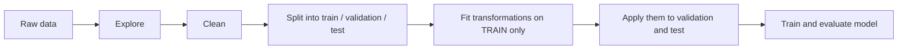

# Lesson 007: Data Science and Preprocessing

**Stage:** 1 (Beginner)  |  **Module:** 1.7  |  **Estimated time:** 5 to 7 hours  |  **Prerequisites:** Lessons 003 (Pandas and NumPy), 005 (statistics, z-scores, MAD), and 006 (you should now be comfortable with the learning loop)

**Where we are:** Lessons 002 to 006 gave you the engine of machine learning: loss, gradients, and gradient descent. But every example so far used tiny, clean, perfectly behaved numbers. Real data is nothing like that. It has missing values, typos, duplicates, impossible numbers, mixed units, and columns in formats a model cannot read. This lesson teaches you how to turn raw, messy data into something a model can learn from **without fooling yourself**. The most important idea is also the most dangerous mistake in the field: **data leakage**, where a model looks brilliant in testing and fails in the real world.

**A motivating fact:** practitioners commonly say that most of the effort in a real ML project goes into data work rather than model work. A mediocre model on excellent data usually beats an excellent model on bad data. For security, data is also the **front door** for attacks: poisoned or manipulated data corrupts a model before it ever runs.

---

## 1. Topic Introduction

**What is data preprocessing?** Everything you do to raw data between "I collected it" and "I feed it to a model": inspecting, cleaning, transforming, and splitting it.

| Stage of the workflow | What happens | Why it matters |
| --- | --- | --- |
| **Explore** | Look at shapes, types, distributions, missing values | You cannot fix what you have not seen |
| **Clean** | Fix missing values, duplicates, typos, impossible values | Models learn whatever is in the data, including mistakes |
| **Transform** | Scale numbers, encode categories, create new features | Models only understand numbers on sensible scales |
| **Split** | Separate training, validation, and test data | Gives an honest measure of performance |
| **Check for leakage** | Make sure no information from the answer slips into the inputs | Otherwise your results are an illusion |



Notice the order: **split first, then fit transformations on the training data only.** That ordering prevents the most common form of leakage, and you will see why in Section 3.9.

**Why it matters for security:**

- **Data poisoning** happens here: manipulated rows or labels slipped into a training set (Lesson 005 and 006 previewed this).
- **Data provenance and integrity**: where did the data come from, and has it been tampered with?
- **Privacy**: training data often contains personal information that must be minimized, masked, or protected.
- **Leakage and benchmark contamination** make security claims untrustworthy: a detector that scores 99% because of leaked information is worthless in production.
- **The pipeline is an attack surface**: untrusted CSV files, huge files, and serialized preprocessing objects can all be abused.

**What you will learn:**

1. How to explore a dataset systematically.
2. Handling missing values, duplicates, inconsistent text, impossible values, and outliers.
3. Scaling numeric features and encoding categorical ones.
4. Feature engineering.
5. Correct train, validation, and test splitting (including stratified and time-based splits).
6. Data leakage: its forms, how to spot it, and how pipelines prevent it.
7. Hands-on cleaning and a leak-proof scikit-learn pipeline.
8. Security labs: a leakage demonstration and a data-integrity and poisoning screen.

---

## 2. Fundamental Concepts

### 2.1 Anatomy of a dataset

| Term | Meaning | Example (customer churn) |
| --- | --- | --- |
| **Sample / example / row / record** | One item of data | One customer |
| **Feature / column / attribute / variable** | A measurable property | Age, plan, income |
| **Target / label** | The value we want to predict (supervised learning) | Did the customer leave? (0 or 1) |
| **Feature matrix X** | All features for all samples | A table: rows are customers, columns are features |
| **Target vector y** | All labels | One column of 0s and 1s |

This is the (m, n) matrix picture from Lesson 004: m samples by n features.

### 2.2 Types of features

The type of a feature decides how it must be prepared.

| Type | Description | Examples | Typical preparation |
| --- | --- | --- | --- |
| **Numerical, continuous** | Any value on a scale | Income, temperature, bytes sent | Scale; check outliers |
| **Numerical, discrete** | Counts | Number of failed logins | Scale or leave; check range |
| **Categorical, nominal** | Categories with no order | Country, plan name, browser | One-hot encode |
| **Categorical, ordinal** | Categories with an order | Low, medium, high; star ratings | Ordinal (integer) encode |
| **Boolean** | Yes or no | Is admin | 0 and 1 |
| **Datetime** | Points in time | Login timestamp | Extract hour, weekday, etc. |
| **Text** | Free-form strings | Emails, prompts, logs | Tokenize and embed (later lessons) |
| **Identifier** | Unique labels with no meaning for prediction | Customer ID, session ID | Usually **drop** (an ID can let a model memorize) |

### 2.3 The golden rule: the test set is a sealed envelope

Your goal is a model that works on **future, unseen data**. To estimate that honestly, you keep a **test set** that the model, and **you**, never use for any decision during development. Every choice you make by looking at the test set (which features to keep, how to fill missing values, which model to pick) quietly leaks information from it into your model, and your final score becomes optimistic. Keep the test set sealed until the very end.

---

## 3. Technical Explanation

### 3.1 Explore first

Before changing anything, look. A reliable first-contact routine (you started this in Lesson 003):

| Command | What it tells you |
| --- | --- |
| `df.shape` | Number of rows and columns |
| `df.head()` / `df.sample(5)` | A feel for the actual values |
| `df.info()` | Column names, data types, non-missing counts |
| `df.describe()` | Count, mean, standard deviation, min, quartiles, max for numeric columns |
| `df.isna().sum()` | Missing values per column |
| `df.duplicated().sum()` | Number of exact duplicate rows |
| `df['col'].value_counts(dropna=False)` | Frequency of each category (and missing) |
| `df['target'].value_counts(normalize=True)` | Class balance |
| `df.hist()` / `df.plot.box()` | Distributions and outliers at a glance |
| `df.corr(numeric_only=True)` | Linear relationships between numeric columns |

**Things to look for:** columns stored as the wrong type (numbers stored as text), impossible values (negative ages), suspiciously constant columns, highly skewed distributions, rare categories, and surprising class balance. Write down every oddity and decide what to do about each.

### 3.2 Missing values

Missing values appear as `NaN` (or `None`, empty strings, or placeholder codes such as -999 or "N/A"; check for these, they hide in plain sight). **Why** a value is missing matters:

| Pattern | Meaning | Example |
| --- | --- | --- |
| **Missing completely at random** | Missingness has nothing to do with anything | A sensor glitch |
| **Missing at random** | Depends on other observed columns | Older users skip an optional field |
| **Missing not at random** | Depends on the missing value itself | High earners decline to state income |

The last kind is the dangerous one: the fact that the value is missing is itself informative.

**Options:**

| Strategy | When it is reasonable | Caution |
| --- | --- | --- |
| **Drop rows** | Few rows affected and missingness is random | Can bias the data or waste a lot of it |
| **Drop the column** | Mostly empty and not important | You may lose a useful signal |
| **Impute with the median** (numeric) | Skewed data or outliers | Shrinks variance; hides the fact it was missing |
| **Impute with the mean** | Roughly symmetric data without outliers | Sensitive to outliers |
| **Impute with the most frequent value or "unknown"** (categorical) | Categorical features | "Unknown" can itself be a useful category |
| **Add a missing-indicator column** | Missingness may carry information | Adds a column |
| **Model-based imputation** | Advanced; more accurate | More complex and easier to leak |

**Numeric example.** Values \[4, 6, missing, 10, 100\]. The mean of the known values is 120 / 4 = **30**, which describes none of the points because of the outlier. The median is (6 + 10) / 2 = **8**, a far more sensible fill. This is the same lesson as in Lesson 005: the median is robust.

**Rule you must remember:** compute the imputation value (the median, the mean, the most frequent category) from the **training set only**, then apply that same value to validation and test data. Using the whole dataset leaks test-set information (Section 3.9).

### 3.3 Duplicates and inconsistencies

Common problems and fixes:

| Problem | Example | Fix |
| --- | --- | --- |
| **Exact duplicate rows** | The same record loaded twice | `df.drop_duplicates()` after deciding which copy to keep |
| **Inconsistent text** | "USA", "usa ", "U.S.A." | `str.strip()`, `str.lower()`, and a mapping dictionary |
| **Wrong data types** | Income stored as "52,000" text | Remove symbols, then `pd.to_numeric(..., errors='coerce')` |
| **Impossible values** | Age of -5 or 250 | Treat as missing, or investigate the source |
| **Mixed units** | Some distances in miles, others in kilometers | Convert to one unit |
| **Placeholder values** | -999, 0, "unknown" meaning missing | Convert to `NaN` |
| **Near-duplicates** | Same person with a slightly different name spelling | Fuzzy matching (advanced) |

**Duplicates deserve special respect:** if copies of the same record end up in both the training and the test set, your evaluation is inflated (a form of leakage you will test in the lab).

### 3.4 Outliers

An **outlier** is a value far from the rest. It might be an **error** (a typo with an extra zero), a **rare but real event** (a wealthy customer), or a **signal** (an attack). Which one it is decides what to do.

Lesson 005 gave you the z-score (fragile) and the MAD (robust). Another popular robust method is the **IQR rule**:

1. Q1 = the value below which 25% of the data lies; Q3 = 75%.
2. IQR (interquartile range) = Q3 - Q1.
3. Flag anything below **Q1 - 1.5 x IQR** or above **Q3 + 1.5 x IQR**.

**Numeric example.** Data: \[10, 12, 12, 13, 14, 15, 16, 95\]. Q1 = 12, Q3 = 15.25, so IQR = 3.25. The upper fence is 15.25 + 1.5 x 3.25 = **20.125** and the lower fence is 12 - 4.875 = **7.125**. The value 95 lies far above the upper fence: flagged. The value 10 is inside the fences: fine. (Quartiles are computed by interpolation, so different tools may differ slightly in small samples.)

**What to do with outliers:**

| Choice | When |
| --- | --- |
| **Investigate first** | Always. Ask what generated it |
| **Fix** | It is clearly an error and the true value is known |
| **Cap (winsorize)** at the fences | Keep the row but limit its influence |
| **Transform** (for example, a logarithm for right-skewed data like income) | The spread is large but legitimate |
| **Remove** | It is an error that cannot be corrected, and removal is documented |
| **Keep** | It is real and informative |

**Security warning:** in **anomaly detection** (finding attacks, fraud, intrusions) the outliers **are the signal**. Removing them during preprocessing would delete exactly what you are trying to detect. Conversely, an attacker who can insert extreme values into training data may be trying to distort your model. Always keep a record of what you removed and why.

### 3.5 Scaling numeric features

Features often live on wildly different scales: age is 18 to 80 while income is 20,000 to 200,000. Many algorithms are sensitive to this:

- **Distance-based methods** (k-nearest neighbors, k-means, SVMs) treat distance in income as far more important than distance in age simply because the numbers are bigger.
- **Gradient-based methods** (neural networks, logistic regression) train faster and more stably when features are on similar scales; badly scaled features make the loss surface long and narrow, which forces tiny learning rates (recall Lesson 006).
- **Tree-based methods** (decision trees, random forests) are mostly **insensitive** to scaling.

**Distance example.** Customer A: age 25, income 50,000. B: age 60, income 50,100. C: age 25, income 60,000.

- Distance A to B = square root of (35 squared + 100 squared) = **105.9**
- Distance A to C = square root of (0 squared + 10,000 squared) = **10,000**

By raw distance, B (35 years older) looks almost identical to A and C (same age, 10,000 more income) looks very far away. The income column drowns out age. Scaling fixes this.

**Two standard scalers:**

```latex
x_{\text{minmax}} = \frac{x - x_{\min}}{x_{\max} - x_{\min}} \qquad\qquad x_{\text{std}} = \frac{x - \mu}{\sigma}
```

- **Min-max scaling** squeezes values into the range 0 to 1. Sensitive to outliers (one huge value squashes everyone else).
- **Standardization** (z-score) gives mean 0 and standard deviation 1. The usual default.

**Numeric example.** Incomes \[30,000, 50,000, 70,000\]:

- Min-max: (30,000 - 30,000) / 40,000 = **0**, (50,000 - 30,000) / 40,000 = **0.5**, **1**.
- Standardization: mean = 50,000; the population standard deviation = square root of ((20,000 squared + 0 + 20,000 squared) / 3) = **16,330**. Scaled values: -20,000 / 16,330 = **-1.225**, **0**, **+1.225**.

**Again the rule:** compute the minimum, maximum, mean, and standard deviation from the **training set only**, then apply those exact numbers to validation and test data and to any new data in production. Never re-fit the scaler on the test set. (This is why the scaler is part of the saved model.)

### 3.6 Encoding categorical features

Models need numbers. How you convert categories matters.

**Ordinal (integer) encoding:** assign 0, 1, 2, ... Appropriate **only when the categories have a natural order** (low = 0, medium = 1, high = 2). For unordered categories it invents a fake order: encoding red = 0, green = 1, blue = 2 tells the model that blue is "twice" green and that red and blue are far apart.

**One-hot encoding:** create one 0/1 column per category.

| color | is\_red | is\_green | is\_blue |
| --- | --- | --- | --- |
| red | 1 | 0 | 0 |
| green | 0 | 1 | 0 |
| blue | 0 | 0 | 1 |

No fake order is introduced. In Pandas: `pd.get_dummies(df, columns=['color'])`. In scikit-learn: `OneHotEncoder`.

**Practical issues:**

| Issue | Explanation | Handling |
| --- | --- | --- |
| **Unseen categories** | Production data contains a category not present in training (a new country) | `OneHotEncoder(handle_unknown='ignore')` |
| **High cardinality** | Thousands of categories (for example, IP addresses or user IDs) make huge, sparse data | Group rare values into "other", hash, use embeddings (later), or drop identifiers |
| **Redundancy** | The columns of a one-hot encoding sum to 1, so one is redundant ("dummy variable trap") | `drop='first'` for linear models if needed |
| **Target encoding** | Replace a category with the average of the target for that category | Powerful but **leaks the target** unless done very carefully inside cross-validation |

### 3.7 Feature engineering

**Feature engineering** means creating new, more informative features from the raw ones. Good features often matter more than the choice of algorithm in classic machine learning. (Deep learning learns many features automatically, but data preparation still matters.)

| Raw data | Engineered feature | Why it helps |
| --- | --- | --- |
| Timestamp `2026-11-09 03:12` | hour = 3, weekday = Monday, is\_off\_hours = 1 | Logins at 3 a.m. behave differently from logins at 3 p.m. |
| failed\_logins = 12, total\_logins = 40 | failure\_rate = 0.30 | A rate is comparable across users; a raw count is not |
| bytes\_sent = 5,000,000, duration = 100 s | bytes\_per\_second = 50,000 | Exfiltration looks like a high rate |
| income = 30,000 / 60,000 / 1,200,000 | log10(income) = 4.48 / 4.78 / 6.08 | A logarithm compresses a long right tail, so one huge value no longer dominates |
| A domain name | length, digit count, character entropy | Randomly generated malware domains look statistically different |
| age = 37 | age\_group = "30 to 39" | Allows non-linear age effects (binning) |
| plan and monthly\_usage | plan multiplied by usage (an interaction) | Captures effects that depend on two features together |

**Principles:**

1. **Use domain knowledge.** Ask what a human expert would look at.
2. **Only use information available at prediction time.** A feature computed from the future is a leak (Section 3.9).
3. **Any statistic you compute from data (a mean, a rank, a category frequency) must come from the training set only.**
4. **Prefer features that are hard for an adversary to fake.** In security, attackers will modify features that are cheap to change (a user-agent string, a payload length). Features based on behavior over time or on infrastructure are more costly to forge.
5. **Do not add features you cannot explain or reproduce.** Every engineered feature is code you must maintain, test, and keep identical between training and production.

### 3.8 Splitting data: training, validation, test

| Set | Used for | How often can you look? |
| --- | --- | --- |
| **Training set** | Fitting the model's parameters (and the preprocessing statistics) | Constantly |
| **Validation set** | Choosing hyperparameters, comparing models, early stopping | Many times during development |
| **Test set** | One final, unbiased estimate of real-world performance | **Once**, at the end |

Typical proportions: **70/15/15** or **60/20/20**. With very large datasets the test fraction can be smaller; with small datasets we use **cross-validation** instead of a fixed validation set (Lesson 012).

```python
from sklearn.model_selection import train_test_split
X_train, X_test, y_train, y_test = train_test_split(X, y, test_size=0.2, random_state=42)
```

The `random_state` fixes the shuffle so the split is reproducible.

**Stratified splits.** When classes are imbalanced, a random split can distort class proportions. Suppose 1,000 samples contain 5% positives (50 positives) and you hold out 20% for testing. You *expect* 10 positives in the test set, but a random split might give 4 or 17, making your test score erratic. **Stratified** splitting forces each split to keep the overall class proportions (exactly 10 positives in test and 40 in train here). In scikit-learn: `train_test_split(X, y, test_size=0.2, stratify=y)`.

**Time-based splits.** If your data has a time order (network logs, transactions, malware samples collected over months), **never shuffle randomly.** Train on the past, validate on the next period, test on the most recent period. A random split lets the model peek at the future and hides **concept drift** (the world changing), which is especially important in security because attackers adapt.

**Group-based splits.** If many rows belong to the same entity (a user, a device, a patient, a malware family), keep **all rows of one entity in the same split.** Otherwise the model learns the entities themselves and your test score only measures memorization. For example, a malware classifier tested on new variants of families it already saw in training will look much better than it would on genuinely new families.

**Document the split.** Save the random seed, the split rule, and ideally a fingerprint (hash) of each split so that results can be reproduced and audited.

### 3.9 Data leakage

**Data leakage** is when information that would not be available in real use (typically information from the test set or from the answer itself) influences the model or the choice of the model. The result is an evaluation that is **too good to be true**, and a model that disappoints in production.

| Type of leakage | Example | Fix |
| --- | --- | --- |
| **Preprocessing leakage** | Fitting the scaler, imputer, or feature selector on the **whole** dataset before splitting | Split first; fit all transformations on the training set only; use a `Pipeline` |
| **Target leakage** | Predicting churn using a column like `cancellation_reason` or `account_status = closed`, which only exists after the customer left | For every feature ask: "Would I have this value at the moment of prediction?" |
| **Duplicate leakage** | The same record (or a near-copy) appears in both train and test | Deduplicate before splitting; check for near-duplicates |
| **Temporal leakage** | Features computed using future data, or a random split of time-ordered data | Time-based split; compute features using only past data |
| **Group or entity leakage** | The same user, device, or malware family appears on both sides | Group-aware splitting |
| **Test-set peeking** | Trying many models and settings and picking the best score *on the test set* | Tune on a validation set or with cross-validation; touch the test set once |
| **Benchmark contamination** | A language model's training data included the benchmark's test questions | Use held-out, newly created, or private test sets; check for overlap |

**Red flags that suggest leakage:**

- Near-perfect accuracy on a hard problem.
- One feature with enormously more importance than all others.
- A big gap between test performance and real-world performance.
- Performance that collapses when you test on a later time period.

**How pipelines prevent preprocessing leakage.** A scikit-learn `Pipeline` bundles preprocessing and the model into one object. When you call `.fit(X_train, y_train)`, every step learns its statistics from the training data only; when you call `.predict(X_test)` or `.score(X_test, y_test)`, the already-fitted steps are applied without re-learning anything. In cross-validation, a pipeline is re-fitted inside each fold, so leakage across folds cannot happen. **Get in the habit of always using pipelines.**

**Why leakage matters for security:** a malware detector, phishing filter, or prompt-injection classifier evaluated with leaked data produces confident marketing numbers and a real-world miss rate that nobody expected. Leaked evaluations are also very hard for outside reviewers to detect.

### 3.10 Imbalanced classes (a short preview)

In security, positives are rare: attacks, fraud, intrusions. You saw in Lesson 005 that accuracy can lie (a model that always says "benign" is 99.9% accurate when attacks are 0.1%). Preview of the toolbox (full treatment in Lesson 012):

- **Stratified splits** so every split contains positives.
- **Better metrics:** precision, recall, F1, and the precision-recall curve instead of accuracy.
- **Class weights:** tell the model that mistakes on the rare class cost more (`class_weight='balanced'` in many scikit-learn models).
- **Resampling:** oversample the rare class or undersample the common one. Do this **only on the training set, after splitting.** If you oversample before splitting, copies of the same record land in both train and test: duplicate leakage.

---

## 4. Important Terminology

| Term | Definition |
| --- | --- |
| **Feature / target** | An input column / the value to predict |
| **Categorical / numerical** | A feature with discrete categories / one with numeric values |
| **Nominal / ordinal** | Categories without order / with natural order |
| **Missing value (NaN)** | An absent entry; can be coded in disguise (-999, "N/A") |
| **Imputation** | Filling in missing values |
| **Missing-indicator** | A 0/1 column recording that a value was missing |
| **Outlier** | A value far from the others |
| **IQR rule** | Flag values beyond 1.5 times the interquartile range from the quartiles |
| **Winsorizing / clipping** | Capping extreme values at a limit |
| **Scaling** | Putting features on comparable ranges |
| **Min-max scaling / standardization** | Squeeze to \[0, 1\] / subtract mean and divide by standard deviation |
| **One-hot encoding** | Turning a category into several 0/1 columns |
| **Cardinality** | The number of distinct values in a categorical feature |
| **Feature engineering** | Creating new informative features from raw data |
| **Training / validation / test set** | Data to fit / to tune / to evaluate finally |
| **Stratified split** | A split that preserves class proportions |
| **Data leakage** | Information from outside the training data (or the answer) influencing the model |
| **Target leakage** | A feature that encodes or reveals the label |
| **Pipeline** | A chain of preprocessing steps and a model fitted and applied as one object |
| **Concept drift** | The relationship between inputs and outputs changing over time |
| **Data provenance** | The documented origin and history of data |
| **Data poisoning** | Deliberately corrupting training data |
| **PII** | Personally identifiable information |

Add these to your `glossary.md`.

---

## 5. Step-by-Step Example: Cleaning a Messy Table by Hand

Here is a small, deliberately messy customer table (10 rows). Look at it carefully before reading the diagnosis.

| customer\_id | age | country | income | plan | churned |
| --- | --- | --- | --- | --- | --- |
| 1 | 34 | USA | 52000 | basic | 0 |
| 2 | 28 | "usa " | 48000 | pro | 0 |
| 3 | missing | Kenya | 61000 | pro | 1 |
| 4 | 45 | kenya | missing | basic | 0 |
| 5 | 31 | UK | 45000 | basic | 0 |
| 5 | 31 | UK | 45000 | basic | 0 |
| 6 | -5 | U.S.A. | 50000 | pro | 1 |
| 7 | 52 | Kenya | 990000 | pro | 0 |
| 8 | 29 | missing | 43000 | basic | 1 |
| 9 | 41 | UK | 58000 | pro | 0 |

**Diagnosis and decisions:**

| Problem | Where | Decision |
| --- | --- | --- |
| Exact duplicate | Customer 5 appears twice | Drop the second copy (9 rows remain) |
| Inconsistent text | "USA", "usa " (trailing space), "U.S.A."; "Kenya" vs "kenya" | Strip spaces, lowercase, map "u.s.a." to "usa". Now: usa 3, kenya 3, uk 2, missing 1 |
| Impossible value | Customer 6 has age -5 | Treat as missing (set to NaN) |
| Missing values | Age (customers 3 and 6), income (customer 4), country (customer 8) | Add missing-indicator columns for age and income first. Fill age with the median of the valid ages (28, 29, 31, 34, 41, 45, 52): **34**. Fill income with the median of the known incomes: **51,000**. Fill country with "unknown" |
| Outlier | Customer 7 income of 990,000 | IQR rule on the 8 known incomes: Q1 = 47,250, Q3 = 58,750, IQR = 11,500. Fences: **30,000** and **76,000**. 990,000 is flagged. Possibly a typo (99,000?) so flag it with an indicator column, and cap it at 76,000 until verified with the data owner |
| Categorical features | country and plan | One-hot encode |
| Identifier | customer\_id | Drop before modeling (it carries no real signal and could allow memorization) |

Notice we never touched the target column `churned` (we only cleaned inputs), and nothing was decided by peeking at which rows churned. In a real project we would also **split first** and compute the medians and fences from the training portion only. The code below does the whole exercise on one table for clarity; Section 6.2 shows the leak-proof version.

---

## 6. Practical Demonstration

Activate your `.venv` (Pandas, NumPy, scikit-learn and SciPy are installed). Predict results before you run.

### 6.1 Cleaning the messy table

```python
# lesson007_messy.py
import numpy as np
import pandas as pd

raw = pd.DataFrame({
    'customer_id': [1, 2, 3, 4, 5, 5, 6, 7, 8, 9],
    'age':     [34, 28, np.nan, 45, 31, 31, -5, 52, 29, 41],
    'country': ['USA', 'usa ', 'Kenya', 'kenya', 'UK', 'UK', 'U.S.A.', 'Kenya', None, 'UK'],
    'income':  [52000, 48000, 61000, np.nan, 45000, 45000, 50000, 990000, 43000, 58000],
    'plan':    ['basic', 'pro', 'pro', 'basic', 'basic', 'basic', 'pro', 'pro', 'basic', 'pro'],
    'churned': [0, 0, 1, 0, 0, 0, 1, 0, 1, 0],
})

# ---------- 1. Explore ----------
print(raw)
raw.info()
print('\nmissing per column:\n', raw.isna().sum())      # age 1, country 1, income 1
print('duplicate rows:', raw.duplicated().sum())          # 1

# ---------- 2. Duplicates and text ----------
df = raw.drop_duplicates().copy()                         # 9 rows remain
df['country'] = (df['country'].str.strip().str.lower()    # remove spaces, lowercase
                 .replace({'u.s.a.': 'usa'}))             # map a variant spelling
print(df['country'].value_counts(dropna=False))           # usa 3, kenya 3, uk 2, NaN 1

# ---------- 3. Impossible values -> missing ----------
df.loc[(df['age'] < 0) | (df['age'] > 120), 'age'] = np.nan

# ---------- 4. Missing-indicator columns (BEFORE filling) ----------
df['age_missing'] = df['age'].isna().astype(int)
df['income_missing'] = df['income'].isna().astype(int)

# ---------- 5. Outliers with the IQR rule ----------
q1, q3 = df['income'].quantile([0.25, 0.75])
iqr = q3 - q1
low, high = q1 - 1.5 * iqr, q3 + 1.5 * iqr
print('Q1, Q3, lower fence, upper fence:', q1, q3, low, high)   # 47250.0 58750.0 30000.0 76000.0
df['income_outlier'] = ((df['income'] < low) | (df['income'] > high)).astype(int)
print(df.loc[df['income_outlier'] == 1, ['customer_id', 'income']])   # customer 7
df['income'] = df['income'].clip(low, high)               # cap at the fences (NaN stays NaN)

# ---------- 6. Fill missing values ----------
age_fill, income_fill = df['age'].median(), df['income'].median()
print('fill values:', age_fill, income_fill)              # 34.0 51000.0
df['age'] = df['age'].fillna(age_fill)
df['income'] = df['income'].fillna(income_fill)
df['country'] = df['country'].fillna('unknown')

# ---------- 7. Encode categories, drop the identifier ----------
df = pd.get_dummies(df, columns=['country', 'plan'], dtype=int)
df = df.drop(columns='customer_id')
print(df)
print('final shape:', df.shape)                           # (9, 12)
```

**What to check:** every printed value should match the diagnosis table in Section 5 (fences 30,000 and 76,000; fill values 34 and 51,000; final shape 9 rows by 12 columns). If a value differs, find out why before moving on.

**Caution:** here we computed medians and fences on the entire table to keep the example small. In real projects, split first and compute them on the training portion only.

### 6.2 A leak-proof preprocessing pipeline

Now the professional version, on a larger synthetic dataset, with a stratified split and a scikit-learn pipeline.

```python
# lesson007_pipeline.py
import numpy as np
import pandas as pd
from sklearn.model_selection import train_test_split
from sklearn.compose import ColumnTransformer
from sklearn.pipeline import Pipeline
from sklearn.impute import SimpleImputer
from sklearn.preprocessing import StandardScaler, OneHotEncoder
from sklearn.linear_model import LogisticRegression
from sklearn.dummy import DummyClassifier
from sklearn.metrics import recall_score

# ---------- synthetic customer data with holes and imbalance ----------
rng = np.random.default_rng(0)
n = 1000
age = rng.normal(40, 12, n).round().clip(18, 80)
income = rng.lognormal(10.8, 0.4, n).round()                 # right-skewed, median about 49,000
plan = rng.choice(['basic', 'pro', 'enterprise'], n, p=[0.6, 0.3, 0.1])
country = rng.choice(['usa', 'kenya', 'uk', 'india'], n)
logit = -2.5 + 0.04 * (40 - age) + 0.8 * (plan == 'basic') - 0.00001 * (income - 49000)
churn = (rng.random(n) < 1 / (1 + np.exp(-logit))).astype(int)   # roughly 10 to 15% churn
df = pd.DataFrame({'age': age, 'income': income, 'plan': plan, 'country': country, 'churn': churn})
df.loc[rng.choice(n, 50, replace=False), 'age'] = np.nan      # punch holes
df.loc[rng.choice(n, 40, replace=False), 'income'] = np.nan

X, y = df.drop(columns='churn'), df['churn']

# ---------- 1) split FIRST, stratified ----------
X_tr, X_te, y_tr, y_te = train_test_split(X, y, test_size=0.2, stratify=y, random_state=42)
print('churn rate  train:', round(y_tr.mean(), 3), ' test:', round(y_te.mean(), 3))   # nearly equal

# ---------- 2) preprocessing recipe (nothing is fitted yet) ----------
numeric, categorical = ['age', 'income'], ['plan', 'country']
prep = ColumnTransformer([
    ('num', Pipeline([('impute', SimpleImputer(strategy='median')),
                      ('scale', StandardScaler())]), numeric),
    ('cat', Pipeline([('impute', SimpleImputer(strategy='most_frequent')),
                      ('onehot', OneHotEncoder(handle_unknown='ignore'))]), categorical),
])
model = Pipeline([('prep', prep), ('clf', LogisticRegression(max_iter=1000))])

# ---------- 3) fit on TRAIN only ----------
model.fit(X_tr, y_tr)

# ---------- 4) look inside ----------
def dense(a): return a.toarray() if hasattr(a, 'toarray') else a
Z_tr = dense(prep.transform(X_tr)); Z_te = dense(prep.transform(X_te))
print('transformed train shape:', Z_tr.shape)                          # (800, 9): 2 numeric + 3 plan + 4 country
print('feature names:', list(prep.get_feature_names_out()))
print('train numeric means:', Z_tr[:, :2].mean(axis=0).round(3))      # essentially 0 (fitted on train)
print('test  numeric means:', Z_te[:, :2].mean(axis=0).round(3))      # close to, but NOT exactly, 0

# ---------- 5) evaluate honestly ----------
dummy = DummyClassifier(strategy='most_frequent').fit(X_tr, y_tr)    # always predicts 'no churn'
print('model accuracy: ', round(model.score(X_te, y_te), 3))
print('dummy accuracy: ', round(dummy.score(X_te, y_te), 3))          # high only because churn is rare
print('model recall on churners:', round(recall_score(y_te, model.predict(X_te)), 3))

# ---------- 6) an unseen category does not crash it ----------
new = pd.DataFrame({'age': [35], 'income': [52000], 'plan': ['pro'], 'country': ['france']})
print('prediction for an unseen country:', model.predict_proba(new)[0].round(3))
```

**What to notice:**

1. The train and test churn rates are almost identical thanks to stratification.
2. Transformed numeric columns on the **training** data have mean about 0 and standard deviation about 1; on the **test** data the mean is close to 0 but not exactly 0. That is **correct**: the test set was scaled with the *training* statistics, exactly as production data will be.
3. The model's accuracy is barely above the dummy classifier that always predicts "no churn", and its recall on actual churners is low. **Accuracy alone hides this** (Lesson 005), which is why Lesson 012 is devoted to proper evaluation.
4. A country never seen in training ("france") does not crash the pipeline because of `handle_unknown='ignore'`.

### 6.3 Security lab A: three ways to fool yourself with leakage

**Learning objectives:** See leakage inflate results, so you recognize it in your own work and in vendor claims.

**Safety:** synthetic data only.

```python
# lesson007_leakage.py   (synthetic data, local only)
import numpy as np
from sklearn.feature_selection import SelectKBest, f_classif
from sklearn.linear_model import LogisticRegression
from sklearn.model_selection import train_test_split
from sklearn.neighbors import KNeighborsClassifier

# ---------- Experiment 1: preprocessing leakage on PURE NOISE ----------
# The labels are random coin flips, so NO model can truly do better than 50%.
leaky, honest = [], []
for seed in range(20):
    rng = np.random.default_rng(seed)
    X = rng.normal(size=(100, 1000))               # 100 samples, 1000 meaningless features
    y = rng.integers(0, 2, 100)                    # random labels

    # WRONG: choose the 20 'best' features using ALL the data, then split
    X_sel = SelectKBest(f_classif, k=20).fit_transform(X, y)
    X_tr, X_te, y_tr, y_te = train_test_split(X_sel, y, test_size=0.3, random_state=seed)
    leaky.append(LogisticRegression(max_iter=1000).fit(X_tr, y_tr).score(X_te, y_te))

    # RIGHT: split first, choose features using the training data only
    X_tr, X_te, y_tr, y_te = train_test_split(X, y, test_size=0.3, random_state=seed)
    sel = SelectKBest(f_classif, k=20).fit(X_tr, y_tr)
    honest.append(LogisticRegression(max_iter=1000).fit(sel.transform(X_tr), y_tr).score(sel.transform(X_te), y_te))

print('Experiment 1 (noise labels):')
print('   leaky  average test accuracy:', round(np.mean(leaky), 3))    # clearly above 0.5: an illusion
print('   honest average test accuracy:', round(np.mean(honest), 3))   # about 0.5, the truth

# ---------- Experiment 2: target leakage ----------
rng = np.random.default_rng(1)
n = 1000
X = rng.normal(size=(n, 5))
y = (X[:, 0] + 0.5 * rng.normal(size=n) > 0).astype(int)      # a real but noisy relationship
leak = y + rng.normal(0, 0.2, n)                               # a column recorded AFTER the outcome
X_leak = np.column_stack([X, leak])

for name, data in [('honest features      ', X), ('with the leaked column', X_leak)]:
    X_tr, X_te, y_tr, y_te = train_test_split(data, y, test_size=0.3, random_state=0)
    m = LogisticRegression(max_iter=1000).fit(X_tr, y_tr)
    print(f'Experiment 2: {name} test accuracy = {m.score(X_te, y_te):.3f}   largest |coefficient| = {np.abs(m.coef_).max():.2f}')

# ---------- Experiment 3: duplicate rows across the split ----------
def knn_score(X, y):
    X_tr, X_te, y_tr, y_te = train_test_split(X, y, test_size=0.25, random_state=0)
    return KNeighborsClassifier(n_neighbors=1).fit(X_tr, y_tr).score(X_te, y_te)

rng = np.random.default_rng(2)
X = rng.normal(size=(300, 5))
y = rng.integers(0, 2, 300)                                   # labels are noise again
print('Experiment 3: no duplicates      ', round(knn_score(X, y), 3))                                  # about 0.5
print('Experiment 3: every row duplicated', round(knn_score(np.vstack([X, X]), np.concatenate([y, y])), 3))   # much higher
```

**Expected (approximately):**

1. **Leaky selection on noise looks impressive** (average accuracy well above 0.5, often 0.7 or more), while the honest procedure sits near 0.5. The features were chosen *because* they happened to correlate with the labels on the very rows used for testing. This is a famous real-world mistake (described in *The Elements of Statistical Learning*, section 7.10.2).
2. **The leaked column pushes accuracy toward 1.0** and gets by far the largest coefficient. In production, that column does not exist yet, so the real accuracy collapses to the honest level.
3. **Duplicated rows inflate a nearest-neighbor model** to well above 0.5 on random labels, because each test row has an identical twin in the training set.

**Security lessons:**

1. A detector's evaluation is only as honest as its split. When someone quotes 99% detection, ask: how was the data split, was preprocessing fitted on training data only, were duplicates and near-duplicates removed, and is the test data from a later time period?
2. Suspiciously strong results deserve suspicion first, celebration later.
3. The same mechanism that leaks test data into a model also makes models **memorize** their training data, which feeds the privacy attacks of Lesson 005.

### 6.4 Security lab B: screening a new data batch for tampering and poisoning

**Learning objectives:** Build a small data-validation routine that fingerprints data, checks ranges, tests for distribution shift, and compares label rates by segment, then see which kinds of poisoning it catches and which it misses.

**Safety:** synthetic data only; you are playing both attacker and defender on your own files.

```python
# lesson007_validate.py   (synthetic data, local only)
import hashlib
import numpy as np
import pandas as pd
from scipy.stats import ks_2samp

def make_customers(n, seed):
    rng = np.random.default_rng(seed)
    age = rng.normal(40, 12, n).round().clip(18, 80)
    income = rng.lognormal(10.8, 0.4, n).round()
    plan = rng.choice(['basic', 'pro', 'enterprise'], n, p=[0.6, 0.3, 0.1])
    logit = -2.5 + 0.04 * (40 - age) + 0.8 * (plan == 'basic') - 0.00001 * (income - 49000)
    churn = (rng.random(n) < 1 / (1 + np.exp(-logit))).astype(int)
    return pd.DataFrame({'age': age, 'income': income, 'plan': plan, 'churn': churn})

def fingerprint(df):                               # a hash of the full contents
    return hashlib.sha256(pd.util.hash_pandas_object(df, index=True).values.tobytes()).hexdigest()

trusted = make_customers(2000, seed=0)             # the approved reference dataset
print('trusted fingerprint:', fingerprint(trusted)[:16])

# tamper with ONE value: the fingerprint changes completely
tampered = trusted.copy()
tampered.loc[0, 'income'] += 1
print('tampering detected by hash:', fingerprint(trusted) != fingerprint(tampered))   # True

# a new incoming batch: one honest, one poisoned
clean_batch = make_customers(300, seed=1)
poisoned = make_customers(300, seed=2)
idx = poisoned.sample(45, random_state=0).index
poisoned.loc[idx, 'income'] *= 5                               # attack 1: shift a feature for 15% of rows
poisoned.loc[poisoned['plan'] == 'pro', 'churn'] = 1           # attack 2: flip labels for one segment

def validate(batch, ref, name):
    print(f'\n--- {name} ---')
    cap = ref['income'].quantile(0.999) * 2
    out_age = ((batch['age'] < 18) | (batch['age'] > 80)).sum()
    out_inc = ((batch['income'] <= 0) | (batch['income'] > cap)).sum()
    print('range check, rows out of range (age, income):', out_age, out_inc)
    for col in ['age', 'income']:                              # distribution shift test per feature
        stat, p = ks_2samp(ref[col], batch[col])
        print(f'KS test {col:6s}: statistic={stat:.3f}  p-value={p:.4f}', ' <-- SHIFTED' if p < 0.01 else '')
    rates = pd.DataFrame({'trusted': ref.groupby('plan')['churn'].mean(),
                          'new batch': batch.groupby('plan')['churn'].mean(),
                          'rows in batch': batch.groupby('plan').size()}).round(3)
    rates['ratio'] = (rates['new batch'] / rates['trusted']).round(2)
    print(rates)                                               # label rate by segment
    print('duplicate rows in batch:', batch.duplicated().sum())

validate(clean_batch, trusted, 'clean batch')
validate(poisoned, trusted, 'poisoned batch')
```

**Expected (approximately; the data is random):**

- Changing a single value changes the hash: `True`. Hashes detect **any** change to approved data, but only tell you *that* it changed, not whether the change was malicious.
- **Clean batch:** KS p-values are usually not small and the churn ratios hover around 1. The small `enterprise` segment (only about 30 rows) can still wander because small groups are noisy: do not over-interpret segments with few rows.
- **Poisoned batch:** the **range check may catch only a few rows or none**, because a 5-times-inflated income is often still below the limit. The **KS test on income flags the shift strongly** (very small p-value) while age looks normal. The `pro` segment's churn rate jumps from about 0.1 to 1.0, a ratio of roughly 8 to 10, so the **per-segment label check** exposes the label attack.

**Security lessons:**

1. **Layered checks catch different things.** Range checks catch absurd values; distribution tests catch shifted features; per-segment label statistics catch targeted label manipulation; hashes catch tampering after approval; none alone is enough.
2. **Statistical screens only catch large or clumsy attacks.** An attacker who changes a tiny fraction of rows, uses plausible values, or plants a backdoor trigger in a handful of examples may pass these tests. Practical web-scale data poisoning has been shown to be feasible (Carlini et al., 2023), so provenance and trusted sources matter as much as statistics.
3. With very large samples, KS tests flag trivial differences; look at the **size** of the shift as well as the p-value.
4. **Hash approved datasets, store them immutably, and log every change.** Reproducible training needs provable data.

Try Exercise 10 to find where the screen stops working.

---

## 7. Real-World Applications

| Task | Where it appears |
| --- | --- |
| Cleaning and validation | Every ML project; data engineering pipelines; regulated industries |
| Imputation and scaling | Credit scoring, healthcare models, sensor data, recommendation systems |
| Encoding | Any model with categories: countries, plans, browsers, process names |
| Feature engineering | Fraud detection, intrusion detection, malware classification, churn prediction |
| Stratified and time-based splitting | Fraud and security models evaluated on future data |
| Pipelines | Production ML systems where the same preprocessing must run at training and serving time |
| Data validation and monitoring | MLOps: catching broken feeds, schema changes, drift, and tampering |
| Leakage audits | Peer review of ML research, vendor evaluations, model risk management |

---

## 8. Cybersecurity Perspective

| Topic | What can go wrong | Defensive habit |
| --- | --- | --- |
| **Training-data poisoning** | Label flipping, shifted features, or backdoor triggers inserted into training data | Provenance, validation screens, drift tests, per-segment label checks, human review of samples, trusted data sources |
| **Web-scale and scraped data** | Public sources can be edited or expired and re-registered by attackers (Carlini et al., 2023, *Poisoning Web-Scale Training Datasets is Practical*) | Snapshot and hash data, prefer curated sources, verify content integrity, monitor for sudden changes |
| **Data integrity and provenance** | Nobody can prove which data produced a model | Hash datasets, version them, keep signed manifests, restrict write access, log changes |
| **Pipeline as attack surface** | Untrusted CSVs can contain formula-injection cells (dangerous when opened in a spreadsheet), huge files, odd encodings, or malformed rows | Validate schema, limit file size and row counts, sanitize cells before exporting to spreadsheets |
| **Serialized preprocessing objects** | Fitted scalers, encoders, and pipelines are often saved with `pickle` or `joblib`, which can execute code on load (Lesson 003) | Only load artifacts you created or can verify; prefer safe formats; scan and sign artifacts |
| **Privacy and PII** | Names, emails, IDs, and free-text fields end up in training data, and models can later memorize and leak them | Data minimization, remove direct identifiers, access control, consider differential privacy. Hashing an identifier is **not** anonymization when the input space is small (dictionary attacks can reverse it). Follow applicable data protection law (for example GDPR or your local data protection law) |
| **Leakage and overstated security claims** | Inflated detector scores from leaked data, contaminated benchmarks | Ask how data was split, deduplicated, and time-ordered; demand fresh held-out tests |
| **Shortcut learning** | A model latches onto an artifact (all benign files signed by one vendor, a watermark, a file extension) instead of real behavior | Check feature importance, test on data from different sources, and remove or randomize shortcuts. Attackers will remove the shortcut to evade |
| **Easy-to-fake features** | Attackers control some features cheaply (user-agent, headers, payload size) | Prefer features that are costly to forge; test robustness to feature manipulation |
| **Concept drift** | Attackers adapt; yesterday's data no longer represents today | Time-based evaluation, drift monitoring, scheduled retraining |
| **Label noise and annotation attacks** | Crowd workers or insiders mislabel data | Multiple annotators, audits, gold-standard checks |
| **Rare-event base rates** | Accuracy hides miss rates (Lesson 005) | Stratify, measure precision and recall, evaluate at realistic prevalence |

**Defender's takeaway:** treat training data like source code that ships to production: version it, review it, verify its origin, and be able to prove what went into every model.

---

## 9. Common Mistakes and Misconceptions

| Mistake | Reality / fix |
| --- | --- |
| Scaling or imputing **before** splitting | Fit on training data only (pipelines do this for you) |
| Looking at the test set to make decisions | The test set is a sealed envelope: tune with validation data or cross-validation |
| Randomly splitting time-ordered data | Use a time-based split; keep the future out of training |
| Letting one entity appear in train and test | Use group-aware splits |
| Ignoring duplicates | Deduplicate before splitting; check for near-duplicates |
| Using an ID column as a feature | Drop identifiers |
| Integer-encoding unordered categories | Use one-hot encoding |
| Filling every missing value with the mean | The median is more robust, and a missing-indicator may carry information |
| Removing all outliers automatically | Outliers may be errors, rare real events, or the attack you want to detect |
| Believing a very high score | Suspect leakage first |
| Oversampling before splitting | Resample only the training set, after splitting |
| Assuming "more data" is always better | More **bad** or poisoned data is worse |
| Treating hashing as anonymization | Low-entropy identifiers can be reversed by brute force |
| Not saving the preprocessing with the model | Production data must go through the identical fitted transformations |

---

## 10. Key Takeaways

- Real data is messy. Explore before changing anything; write down every oddity and decide what to do about it.
- Handle **missing values, duplicates, inconsistent text, impossible values, and outliers** deliberately. The median and the IQR rule are robust. In security data, outliers may be the signal.
- **Scale** numeric features for distance-based and gradient-based models; **one-hot encode** unordered categories; drop identifiers.
- **Feature engineering** (ratios, time parts, logs, domain features) can matter more than the algorithm. Features must exist at prediction time.
- **Split first**, then fit every transformation on the **training set only**. Use stratified, time-based, and group-based splits where appropriate. The test set is touched once.
- **Data leakage** makes results look better than reality. Use pipelines, deduplicate, check timelines, and be suspicious of results that look too good.
- Security: data is the front door. **Fingerprint, validate, and monitor** data; screens catch clumsy attacks but not all; provenance matters. Protect PII, treat serialized preprocessing objects as untrusted code, and question any quoted detection rate.

---

## 11. Exercises

**Exercise 1 (diagnose by hand).** Without looking at Section 5, list every data quality problem you can find in the 10-row customer table, then compare with the diagnosis table. Which did you miss?

**Exercise 2 (IQR by hand).** For \[20, 22, 23, 24, 25, 26, 28, 95\], compute Q1, Q3, the IQR, and both fences by hand, then check with `np.percentile`. Compare with the z-score method and the MAD method from Lesson 005. Which methods flag 95?

**Exercise 3 (scaling by hand).** For \[10, 20, 30, 100\], compute the min-max scaled values and the standardized values (population standard deviation). What does the outlier 100 do to the min-max values of the other three? What does it do to the standardized values?

**Exercise 4 (encoding).** One-hot encode \[red, green, blue, green, red, red\] by hand and with `pd.get_dummies`. Then explain why integer-encoding "country" is wrong but integer-encoding "low / medium / high" is acceptable.

**Exercise 5 (harder cleaning).** Extend `lesson007_messy.py` with three new rows: income given as the text `'52,000'`, age `250`, and country `'Kenya.'` (trailing period). Update the cleaning code so all three are handled (hint: `str.replace(',', '')` followed by `pd.to_numeric(..., errors='coerce')`, and a country mapping). Print the cleaned table.

**Exercise 6 (stratification).** A dataset has 1,000 rows and 3% positives. (a) How many positives do you expect in a 20% test set? (b) Run 1,000 random splits **without** stratification and record the minimum and maximum number of test positives. (c) Repeat **with** `stratify=y`. Summarize the spread in a sentence.

**Exercise 7 (pipelines).** In `lesson007_pipeline.py`: (a) swap `StandardScaler` for `MinMaxScaler` and compare results; (b) add `class_weight='balanced'` to the logistic regression and compare **recall** and accuracy; (c) add a `log_income` feature before the pipeline and see whether it helps. Explain why accuracy fell while recall rose in (b), and which you would prefer for a churn-prevention campaign.

**Exercise 8 (leakage hunt).** For each scenario, say whether leakage is present and why: (a) predicting loan default using a column `collections_calls_made`; (b) normalizing the entire dataset with the global mean and standard deviation before splitting; (c) predicting tomorrow's stock move with a random split of daily data; (d) a phishing detector tested on URLs from the same campaigns that appear in training; (e) a pipeline that imputes with the median **inside** cross-validation.

**Exercise 9 (Lab A).** Run `lesson007_leakage.py`. Report all numbers. Then change `k=20` to `k=5` and `k=100` in Experiment 1, and explain how the size of the illusion changes. Finally, write three sentences explaining why the honest result is about 0.5.

**Exercise 10 (Lab B).** Run `lesson007_validate.py`. Then design a **subtler** poisoning: shift only 5% of rows by +10% income, or flip labels on only 10 rows of one segment. Does the screen notice? Try batch sizes of 300 and 3,000. Write a short note on how detection power depends on the attack size and the batch size, and list two additional defenses you would add (for example, canary records, review of a random sample, separate trusted validation data).

**Exercise 11 (threat model).** You plan to train a phishing-email classifier on data scraped from public sources and community-submitted reports. List at least five ways an attacker could corrupt the data, and for each give one control.

**Exercise 12 (teach it back).** Explain data leakage to a non-technical manager in 6 to 8 sentences using an exam analogy of your own (for example, a student who sees the answer key before the test).

---

## 12. Knowledge Assessment

1. What are the main stages of preprocessing, and why must splitting come before fitting transformations?
2. List five types of features and how each is typically prepared.
3. Why is the median usually a safer fill value than the mean? Give a numeric example.
4. What three questions would you ask before deciding to remove an outlier?
5. State the IQR rule. Why is it more robust than a z-score threshold?
6. Why can removing outliers be harmful in anomaly detection?
7. Why does scaling matter for k-nearest neighbors and gradient-based models, but much less for decision trees?
8. Compute the min-max and standardized values of \[30, 50, 70\].
9. Why is it wrong to fit a scaler on the whole dataset before splitting?
10. What is one-hot encoding, and when is it better than integer encoding?
11. What does `handle_unknown='ignore'` do, and why is it needed in production?
12. What are training, validation, and test sets used for? How often can you look at each?
13. When should you use stratified, time-based, and group-based splits?
14. Define data leakage. List four forms and an example of each.
15. Why can a model that scores 99.9% in testing perform poorly in production? Name three possible causes.
16. How does a scikit-learn `Pipeline` help prevent leakage?
17. Why might oversampling before splitting inflate your results?
18. Name four checks in a data-validation screen and what kind of tampering each can catch.
19. Why do hashes detect tampering but not poisoning of the original data?
20. Why is hashing an email address not a reliable way to anonymize it?
21. What is shortcut learning, and how can it help an attacker evade a detector?
22. *Challenge:* A vendor claims their prompt-injection detector catches 99% of attacks. List five questions about their data and evaluation that you would ask.
23. *Challenge:* An attacker can add 1% of the rows to your training data. Describe, in general terms, how you would check whether those rows could change the model's behavior, and what would limit your ability to detect it.

Send me your answers (and any outstanding answers from earlier lessons) and I will grade them and adapt the next lesson.

---

## Further Reading and References

- scikit-learn user guide: *Preprocessing data*, *Pipelines and composite estimators*, *Cross-validation*, and the section on **common pitfalls and recommended practices** (which covers data leakage). Check the docs for your installed version.
- Pandas user guide: *Working with missing data*, *Group by*, and *Merge, join, concatenate*.
- Hastie, Tibshirani, Friedman, *The Elements of Statistical Learning* (free PDF): section 7.10.2, "The wrong and right way to do cross-validation".
- Kaufman, Rosset, Perlich, Stitelman (2012), *Leakage in Data Mining: Formulation, Detection, and Avoidance*.
- Kapoor and Narayanan (2023), *Leakage and the Reproducibility Crisis in Machine-Learning-Based Science* (Patterns).
- Kuhn and Johnson, *Feature Engineering and Selection: A Practical Approach for Predictive Models* (free online).
- Carlini et al. (2023), *Poisoning Web-Scale Training Datasets is Practical*.
- Gebru et al., *Datasheets for Datasets*, and Mitchell et al., *Model Cards for Model Reporting*: documentation practices for data and models.
- OWASP Top 10 for LLM Applications (the data and model poisoning entry) and MITRE ATLAS (the techniques for poisoning training data). Check each site for the current version.

---

## Glossary additions (copy into `glossary.md`)

Feature, target, categorical, numerical, nominal, ordinal, missing value, imputation, missing-indicator, outlier, IQR, winsorizing, scaling, min-max scaling, standardization, one-hot encoding, cardinality, feature engineering, training set, validation set, test set, stratified split, time-based split, group split, data leakage, target leakage, benchmark contamination, pipeline, concept drift, data provenance, fingerprint (hash), data poisoning, shortcut learning, PII, KS test.

---

## Next Steps

1. Save this document as `notes/stage1-beginner/lesson-007-data-preprocessing.md`.
2. Do Exercises 1 to 4 by hand first, then run all the scripts and both security labs, predicting each result before you run it.
3. Start a **data checklist** file (`data_checklist.md`) with the habits from this lesson: explore, clean, split first, pipeline, leak check, validate and fingerprint. You will reuse it in every project.
4. Complete the assessment, then update `progress.md` and the Progress tab of your spreadsheet (Lesson 007 done).

**Lesson 008 preview:** *Supervised Learning I: Regression.* Linear regression from the ground up (using today's pipeline and Lesson 006's gradient descent), polynomial features, the difference between underfitting and overfitting, bias and variance, and regularization (ridge and lasso). Security angle: how overfitting and regularization relate to the privacy leakage you saw in Lesson 005, and how outliers and poisoned points can drag a regression line.
